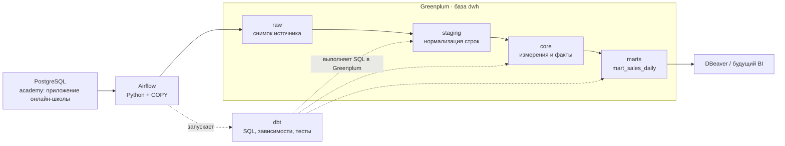
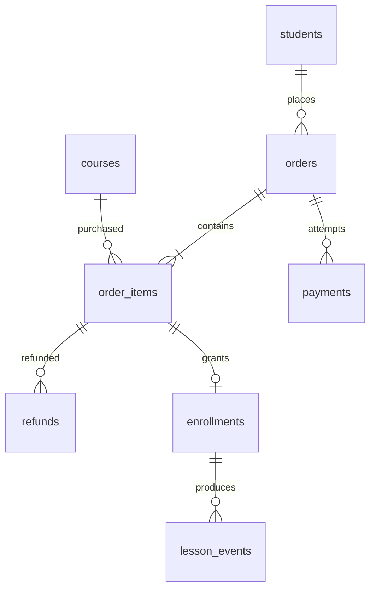

# DWH онлайн-школы: архитектура и сценарий гайда

Полный сценарий записи начинается с [установки Git, VS Code, DBeaver и Docker](VIDEO_SCRIPT.md#setup-from-zero), затем ведёт через запуск и подключения к разбору данных, DAG и SQL-моделей. Реплики, действия на экране и результаты собраны в [VIDEO_SCRIPT.md](VIDEO_SCRIPT.md). Ниже — описание архитектуры и краткая карта выпуска.

## 1. Что получится у зрителя

Зритель выбирает набор сервисов Docker Compose. Базовый запуск даёт Airflow с установленным dbt. Профиль `source` добавляет Postgres с данными онлайн-школы, а профиль `dwh` — источник, Greenplum и автоматическую сборку витрины. Для полного видео используем профиль `dwh`. В видео полностью разбирается **одна витрина — `marts.mart_sales_daily`**, от источника через raw, staging и core до показателей и тестов. Она отвечает на вопрос: сколько приносят продажи каждого курса по дням с учётом скидок и возвратов?

После примера зритель выполняет [два самостоятельных задания](EXERCISES.md):

1. `mart_student_ltv` — накопленные покупки каждого студента.
2. `mart_course_performance` — продажи курсов и прогресс обучения. Здесь нужно самостоятельно добавить очистку событий и факт прогресса.

В заданиях есть входные данные, правила расчёта, критерии приёмки и раскрывающиеся подсказки. Готовые SQL-решения в проект не включены. Стартовый DAG строит только пример продаж и не требует выполнения заданий.

Предметная область выбрана как учебное допущение: **онлайн-курсы**. Все люди и операции синтетические. Даты и значения фиксированы, поэтому запись можно повторить с теми же результатами. Postgres сразу содержит данные для примера и обоих заданий; Airflow загружает в raw все восемь таблиц.

## 2. Архитектура



**Airflow — оркестратор:** задаёт порядок, повторяет упавшие задачи, показывает состояние и логи. Python-задача выполняет перенос данных. **dbt** собирает зависимости SQL-моделей и запускает SQL внутри Greenplum.

dbt установлен в отдельное Python-окружение `/opt/dbt-venv` в образе Airflow. Постоянный отдельный dbt-сервер для этого сценария не нужен. Код проекта смонтирован в `/dbt`, результаты и логи пишутся в том Airflow.

Полный профиль `dwh` запускает три базы и два постоянных процесса Airflow. Два одноразовых сервиса подготавливают окружение:

| Компонент | Когда запускается | Роль |
|---|---|---|
| `client-postgres` | `source` или `dwh` | Бизнес-источник: студенты, покупки, события обучения |
| `airflow-postgres` | Всегда | Служебные метаданные Airflow |
| `greenplum` | `dwh` | DWH: координатор и два primary-сегмента внутри одного контейнера |
| `airflow-scheduler` | Всегда | Планирование и выполнение задач через LocalExecutor |
| `airflow-webserver` | Всегда | Интерфейс Airflow |
| `airflow-init` | Всегда | Однократные миграции метаданных и создание пользователя |
| `dwh-init` | `dwh` | После готовности баз и Airflow включает DAG `academy_dwh` |

Для небольшого стенда выбран LocalExecutor. Это уменьшает число сервисов и расход памяти. Предыдущая конфигурация использовала Celery, Redis, worker, triggerer и Flower. Исходные учебные DAG-и и dbt-проект сохранены в `examples/legacy`.

### Поэтапное развёртывание

```bash
# Airflow, его метаданные и установленный dbt:
docker compose up --build --detach --wait --wait-timeout 600
# Добавить только бизнес-источник:
docker compose --profile source up --build --detach --wait --wait-timeout 600
# Добавить Greenplum и включить цепочку до витрины:
docker compose --profile dwh up --build --detach --wait --wait-timeout 600
docker compose exec -T airflow-scheduler python /opt/airflow/scripts/smoke_test.py --initial-only
```

Сразу выполнять все три команды не обязательно: начни с нужного набора. При первой регистрации DAG `academy_dwh` находится на паузе, поэтому базовый Airflow не пытается подключиться к отсутствующим базам. В профиле `dwh` одноразовый `dwh-init` снимает паузу; `@once` создаёт первый автоматический запуск. Успешное завершение `airflow-init` и `dwh-init` с кодом 0 — штатное состояние.

Airflow хранит состояние паузы и историю в своей базе. Уже выполненный `@once` не повторяется при переключении профиля; новый расчёт запускай через Trigger DAG. Если полный стенд уже работал, переход к меньшему набору требует явно остановить дополнительные контейнеры: команды есть в [разделе перезапуска](#10-перезапуск-и-диагностика).

## 3. Как разделить слои

Слои — схемы в одной базе `dwh` Greenplum.

| Слой | Ответственность | Пример | Материализация |
|---|---|---|---|
| `raw` | Исходные значения плюс сведения о загрузке | `raw.payments`: успешные и неуспешные попытки, исходный регистр статусов | Таблицы, загружает Python |
| `staging` | Приведение строк и статусов | `stg_students`: `lower(trim(email))`; очистка оплат и возвратов | Представления dbt |
| `core` | Общая бизнес-модель, измерения и факты | `dim_students`, `dim_courses`, `fct_orders`, `fct_order_items` | Таблицы dbt |
| `marts` | Показатели под конкретный вопрос | `mart_sales_daily`: продажи по дате заказа и курсу | Таблица dbt |
| `etl` | Технический учёт загрузок | `load_audit`: запуск, таблица, число строк и время | Служебные таблицы |

Здесь очищенный слой называется **staging**. `core` отвечает за бизнес-смысл: какая строка является заказом, какие оплаты успешны, как учесть возвраты. Наличие чистых строк ещё не означает готовую бизнес-модель.

Для core выбрана размерная модель: измерения и факты. Она позволяет за одно видео показать детализацию, связи и агрегации. Ключи источника сохраняются: пока источник один, составные бизнес-ключи и отдельные surrogate keys не нужны.

Измерения содержат **текущие значения (SCD Type 1)**. Если студент меняет город, `dim_students` обновится. Исторический город на дату покупки в этом варианте не хранится. Data Vault и SCD Type 2 можно вынести в следующий выпуск.

### Детализация готового core

| Модель | Одна строка — это | Ключ распределения Greenplum |
|---|---|---|
| `dim_students` | Студент | `student_id` |
| `dim_courses` | Курс | `course_id` |
| `fct_orders` | Заказ, включая неоплаченные и отменённые | `order_id` |
| `fct_order_items` | Позиция заказа: один курс | `order_id` |

Распределение по `order_id` совмещает позиции одного заказа на сегменте. Другие JOIN могут потребовать обмена данными между сегментами. На этом объёме это учебный выбор; поведение MPP можно показать через `EXPLAIN` и `gp_segment_id`. Оба сегмента используют ресурсы одного компьютера.

### MPP в этом стенде

`GREENPLUM_DEPLOYMENT=singlenode` означает размещение кластера на одной машине. В контейнере работают отдельные процессы координатора (порт 5432) и двух primary-сегментов (6000 и 6001). Greenplum распределяет строки и выполняет части запроса параллельно на сегментах. Зеркальных сегментов и standby-координатора в учебной конфигурации нет.

В [demo_queries.sql](demo_queries.sql) есть три проверки для видео:

1. `gp_segment_configuration` показывает координатор (`content=-1`) и сегменты (`content=0,1`) со статусом `u`.
2. `gp_segment_id` показывает физическое размещение строк: в исходном `core.fct_order_items` по 400 строк на каждом сегменте.
3. `EXPLAIN` агрегации по `course_id` показывает `Redistribute Motion 2:2` и `Gather Motion 2:1`: обмен между сегментами и сбор результата на координаторе. В проверенном запуске использовался GPORCA.

На маленьком наборе данных показываем устройство MPP. Для измерения ускорения потребуется больший объём и сравнение планов. Разнесение сегментов по разным машинам и восстановление из зеркала — отдельный сценарий отказоустойчивости.

## 4. Данные в Postgres

Источник находится в схеме `academy`. `client-postgres-init/01_academy.sql` создаёт структуру и данные одной транзакцией.

| Таблица | Строк при первом запуске | Одна строка |
|---|---:|---|
| `students` | 200 | Студент с email, городом и каналом привлечения |
| `courses` | 6 | Курс с ценой и числом уроков |
| `orders` | 400 | Заказ студента |
| `order_items` | 800 | Курс в заказе; два курса в каждом исходном заказе |
| `payments` | 366 | Попытка оплаты; 320 успешных и 46 неуспешных |
| `refunds` | 51 | Возврат по позиции: обработанный или запрошенный |
| `enrollments` | 640 | Зачисление после оплаты позиции |
| `lesson_events` | 4 223 | Доставка события обучения; 3 700 логических событий |

Курсы: SQL, Python, проектирование DWH, Airflow, dbt и Greenplum. Заказы распределены по январю–марту 2026 года. События обучения и возвраты могут происходить позже заказа. Студенты зарегистрированы в декабре 2025 года.

Связи:



### Что делает данные полезными для демонстрации

- Email с пробелами и разным регистром. В raw виден оригинал, в staging — нормализованное значение.
- Пустые и отсутствующие города. В staging они превращаются в `Не указан`.
- Статусы `PAID `, ` pending `, `Succeeded ` и ` failed`. Пробелы и регистр убираются до расчётов.
- Несколько попыток оплаты одного заказа. Неуспешная попытка не увеличивает продажи.
- Скидки и частичные возвраты. Заявка на возврат не уменьшает продажи до статуса `processed`.
- Повторные доставки событий с одним `event_id`. В источнике первичный ключ — `delivery_id`, поэтому повторная доставка допустима.
- Зачисления без событий. В задании нужно сохранить студентов с нулевым прогрессом.

Данные для обучения сохраняются в Postgres и raw. Их очистка и расчёт прогресса выполняются в самостоятельном задании.

Все деньги заданы **целым числом копеек**. В витринах используется деление на `100.0`; расчёт выполняется в SQL с точными числовыми типами. Валюта одна — RUB. Одна позиция содержит один курс, количество всегда равно единице.

## 5. Правила расчёта готовой витрины

### Продажи

- Стоимость позиции = цена на момент заказа − скидка.
- Успешные оплаты сначала суммируются **до одной строки на заказ**.
- Обработанные возвраты сначала суммируются **до одной строки на позицию**.
- После этих агрегаций выполняются JOIN с позициями заказа. Так повторы платежей и несколько возвратов не размножают суммы.
- Оплаченный заказ должен быть полностью оплачен. Несколько успешных платежей допустимы, если сумма совпадает со стоимостью заказа. Частичная оплата вызывает ошибку проверки.
- Продажи после возвратов = оплаченная стоимость позиций − обработанные возвраты.

`mart_sales_daily` имеет детализацию **дата заказа UTC × курс**. Возврат относится к дате исходного заказа: прошлые даты могут измениться после возврата. Для движения денег по дате оплаты/возврата нужна отдельная витрина денежных операций.

`paid_orders` внутри курса нельзя суммировать по всем курсам, чтобы получить число уникальных заказов: один заказ содержит два курса. Для общего количества используй `core.fct_orders`.

### Что остаётся для самостоятельной работы

Расчёт покупок студента, очистка событий обучения и построение факта прогресса описаны в [EXERCISES.md](EXERCISES.md). В текущем проекте этих моделей нет. Для первого задания можно использовать готовые измерения и факты продаж. Второе задание проходит дополнительные шаги от raw-данных обучения до собственной витрины.

## 6. Почему полный DWH запускается одной командой

```bash
docker compose --profile dwh up --build --detach --wait --wait-timeout 600
```

1. При пустом томе официальный Postgres-образ выполняет SQL из `/docker-entrypoint-initdb.d`.
2. Greenplum создаёт базу `dwh` и свой локальный кластер.
3. Healthcheck источника проверяет существование таблицы заказов через TCP. Проверка Greenplum обращается к сегментам.
4. `airflow-init` мигрирует метаданные и создаёт пользователя `airflow`.
5. Scheduler стартует после успешного `airflow-init` и регистрирует новый DAG на паузе.
6. Сервис `dwh-init` ждёт готовности источника, Greenplum и scheduler, затем включает DAG `academy_dwh`. Webserver готов к работе после завершения этой инициализации.
7. Расписание `@once` создаёт первый автоматический расчёт.

Данные источника не надо скачивать из API. После первой сборки и загрузки образов внешний источник данных для работы DAG не нужен.

**Init-скрипты Postgres выполняются только на пустом томе.** Изменение SQL-файла не изменяет уже созданную базу. Повторный `docker compose --profile dwh up -d` сохраняет данные и не выполняет seed повторно. Для новых изменений используй отдельный SQL-скрипт.

Именованные тома хранят данные источника, Greenplum, метаданные и логи Airflow. Фиксированный hostname `greenplum` нужен для повторного старта его кластера.

### Если уже запускал предыдущий стенд

Новая конфигурация использует имя Compose-проекта `localstand-dwh` и отдельный том метаданных Postgres 16. Прежние данные Postgres 13 автоматически не мигрируют. Перед запуском останови старый Compose-проект из прежней конфигурации, чтобы освободить порты 5051 и 8080. Его тома можно сохранить для возврата к старому примеру.

## 7. Как выполняется загрузка

```text
load_raw
  → dbt_staging
  → dbt_core
  → dbt_marts
  → dbt_test_all
  → verify_marts
```

Для первого выпуска выбрана **полная загрузка текущего снимка**. Несколько тысяч строк позволяют сделать её понятной и воспроизводимой.

- Postgres читается в транзакции `REPEATABLE READ`: все восемь таблиц относятся к одному согласованному снимку.
- Данные передаются через `COPY TO STDOUT` → временный файл → `COPY FROM STDIN`.
- В Greenplum все raw-таблицы заменяются одной транзакцией. При сбое прежний снимок и журнал загрузки сохраняются.
- `_batch_id` связывает строки с запуском Airflow, `_loaded_at` содержит время загрузки.
- После копирования проверяется число строк каждой таблицы.
- В XCom возвращаются только небольшие счётчики. Сами строки через XCom не передаются.
- `max_active_runs=1` не позволяет двум запускам этого DAG одновременно перестраивать модели.
- Повторный запуск сохраняет бизнес-результат. Техническое время загрузки меняется; в `etl.load_audit` остаётся история запусков.

`raw` здесь хранит **последний снимок**, а не все исторические версии. Удалённая строка исчезнет при следующей полной загрузке. Журнал загрузок хранит числа строк, но не позволяет восстановить прежние данные.

Атомарность действует на raw-загрузку. dbt фиксирует модели по отдельности: во время пересборки downstream-таблицы могут относиться к разным запускам. В этом стенде читать витрины нужно после успешного DAG. Для публикации непротиворечивого DWH под постоянной BI-нагрузкой понадобится отдельная схема сборки и переключение представлений после всех проверок.

## 8. Проверки и контрольные значения

Готовый пример содержит 11 моделей и 72 dbt-проверки: уникальность ключей, обязательные значения, связи, статусы и сверки денег. Проверки для новых учебных моделей студент добавляет самостоятельно. Отдельные слои строятся через `dbt build`, затем `dbt test` проверяет весь граф, включая межслойные связи и raw-источники.

| Показатель | Исходные данные | После `demo_changes.sql` |
|---|---:|---:|
| Заказы | 400 | 401 |
| Оплаченные заказы | 320 | 321 |
| Позиции заказов | 800 | 802 |
| Зачисления в raw для заданий | 640 | 642 |
| Доставки событий в raw | 4 223 | 4 225 |
| Продажи до возвратов, после скидок | 7 322 400 ₽ | 7 350 200 ₽ |
| Обработанные возвраты | 164 290 ₽ | 164 290 ₽ |
| Продажи после возвратов | **7 158 110 ₽** | **7 185 910 ₽** |

Проверить текущий результат:

```bash
docker compose exec -T airflow-scheduler python /opt/airflow/scripts/verify_warehouse.py --expected baseline
```

Сразу после `docker compose --profile dwh up` DAG может ещё выполняться. Дождаться его автоматического завершения и проверить результат можно одной командой:

```bash
docker compose exec -T airflow-scheduler python /opt/airflow/scripts/smoke_test.py --initial-only
```

Полная проверка также подтверждает наличие успешного автоматического запуска, затем запускает DAG дважды и сравнивает показатели. Проверка результата контролирует готовность primary-сегментов и распределение позиций заказов:

```bash
docker compose exec -T airflow-scheduler python /opt/airflow/scripts/smoke_test.py
```

После неё, когда нет активных запусков DAG, можно проверить откат. Скрипт намеренно прерывает COPY после нескольких таблиц и сравнивает raw и журнал до/после:

```bash
docker compose exec -T airflow-scheduler python /opt/airflow/scripts/check_rollback.py
```

Фактический статус проверок зафиксирован в [VALIDATION.md](VALIDATION.md). Успешный `dbt parse` проверяет проект, но не заменяет выполнение в Greenplum.

## 9. Порядок показа в видео

Подробный выпуск с установкой и выполнением запросов рассчитан примерно на 130–150 минут после монтажа. Полные реплики и команды — в [VIDEO_SCRIPT.md](VIDEO_SCRIPT.md).

| Этап | Что показать | Что должен понять зритель |
|---|---|---|
| 1 | Установка Git, VS Code, DBeaver и Docker для своей ОС | Какие программы нужны и как проверить их готовность |
| 2 | Clone, открытие проекта, выбор профиля, Compose и проверка первого DAG | Как запустить Airflow отдельно и затем добавить весь DWH с данными |
| 3 | Два подключения DBeaver, первые запросы, вход в Airflow | Где открыть источник, DWH, граф задач и логи |
| 4 | Витрина продаж и схема потока | Какой бизнес-вопрос решаем и какую роль играет каждый инструмент |
| 5 | Таблицы Postgres и заказ №308 | Детализация данных, попытки оплаты, скидка и возврат |
| 6 | Compose, библиотеки, Greenplum MPP | Откуда взялось окружение и как распределены данные |
| 7 | DAG, загрузчик, raw и staging | Как переносится согласованный снимок и очищаются значения |
| 8 | Факты, измерения, витрина и проверки | Как избежать удвоения денег и проверить результат |
| 9 | Новый заказ, изменение города, повторный DAG | Как обновляются слои и какие версии данных сохраняются |
| 10 | Два задания, остановка и продолжение на следующий день | Что сделать самостоятельно и как сохранить результат работы |

В кадре проходим установку и первый запуск последовательно. Скачивание и ожидание можно сократить монтажом, сохранив команду, результат и объяснение каждого шага.

SQL для демонстрации находится в [demo_queries.sql](demo_queries.sql). Его можно выполнить целиком:

```bash
bash scripts/gp_sql.sh < docs/demo_queries.sql
```

### Демонстрация обновления

```bash
docker compose exec -T client-postgres psql -U postgres -d postgres -v ON_ERROR_STOP=1 < scripts/demo_changes.sql
docker compose exec -T airflow-scheduler airflow dags trigger academy_dwh
```

После зелёного DAG:

```bash
docker compose exec -T airflow-scheduler python /opt/airflow/scripts/verify_warehouse.py --expected changed
```

Скрипт добавляет студенту №1 заказ №1001 с курсами DWH и dbt на 27 800 ₽, меняет его город и создаёт две доставки одного события. Повтори SQL и DAG: заказ и суммы не удвоятся.

### Показать dbt lineage

После успешной загрузки:

```bash
docker compose exec -T airflow-scheduler /opt/dbt-venv/bin/dbt docs generate --project-dir /dbt --profiles-dir /dbt
docker compose run --rm --no-deps --entrypoint /opt/dbt-venv/bin/dbt -p 127.0.0.1:8081:8081 airflow-scheduler docs serve --project-dir /dbt --profiles-dir /dbt --port 8081 --no-browser
```

Открой [localhost:8081](http://localhost:8081). Команда serve занимает терминал; остановка через Ctrl+C. Генерация каталога также требует работающего Greenplum.

## 10. Перезапуск и диагностика

```bash
# Остановить все сервисы, сохранив данные:
docker compose --profile dwh stop
# Вернуться ко всему DWH:
docker compose --profile dwh up --detach --wait --wait-timeout 600
# Пересобрать образ после изменения зависимостей:
docker compose --profile dwh up --build --detach --wait --wait-timeout 600
```

`@once` не запускает DAG заново после каждого рестарта. Для новой загрузки нажми Trigger DAG или используй CLI-команду выше.

Чтобы оставить только Airflow + dbt, сначала дождись завершения текущего DAG. Затем:

```bash
docker compose exec -T airflow-scheduler airflow dags pause academy_dwh
docker compose --profile dwh stop dwh-init greenplum client-postgres
```

Пауза запрещает новые запуски по расписанию, но не отменяет уже выполняющиеся задачи. Запуск `docker compose up` без профиля сам по себе не останавливает ранее запущенный Greenplum. При следующем `--profile dwh up` сервис `dwh-init` включит DAG, а базы продолжат работу с сохранёнными данными.

Чтобы заново получить исходный демонстрационный набор, **удали все тома этого стенда**. Это также удалит историю Airflow, текущие данные Greenplum и изменения в источнике:

```bash
docker compose --profile dwh down --volumes
docker compose --profile dwh up --build --detach --wait --wait-timeout 600
docker compose exec -T airflow-scheduler python /opt/airflow/scripts/smoke_test.py --initial-only
```

Для удаления контейнеров с сохранением томов используй `docker compose --profile dwh down`.

| Симптом | Что проверить |
|---|---|
| `docker: command not found` | Установить Docker Desktop либо Docker Engine и Compose v2, затем запустить движок |
| Порт занят | Остановить прежний стенд или указать другие порты через `.env.example` |
| Greenplum долго стартует | `docker compose logs --tail 200 greenplum`; проверить выделенную RAM и место |
| Webserver не запускается | `docker compose logs airflow-init`; инициализация должна закончиться с кодом 0 |
| Нет Greenplum или источника | Выбран базовый набор; запустить `docker compose --profile dwh up --build --detach --wait --wait-timeout 600` |
| DAG на паузе | На новой базовой установке это ожидаемо; в полном наборе проверить `docker compose --profile dwh logs dwh-init` |
| DAG не появился | `docker compose exec -T airflow-scheduler airflow dags list-import-errors` |
| Упал dbt | Открыть лог соответствующей задачи; при необходимости запустить `dbt debug --project-dir /dbt --profiles-dir /dbt` через `/opt/dbt-venv/bin/dbt` |
| Изменение seed SQL не видно | Init SQL выполняется только при пустом томе; применить отдельную миграцию/демонстрационный скрипт |

Для загрузки SQL в Greenplum используй `bash scripts/gp_sql.sh`. Скрипт настраивает окружение клиента, которое требуется выбранному образу.

## 11. Что вынести в следующие выпуски

1. **Инкремент.** Добавить журнал курсоров по таблицам, перекрывающееся окно чтения и обновление по ключу. Продвигать курсор только после успешной фиксации; отдельно разобрать поздние изменения, границы окна и транзакции источника.
2. **Удаления.** Ввести soft delete или CDC. Простая фильтрация по `updated_at` физическое удаление не обнаружит.
3. **История.** Добавить append-only raw и SCD Type 2 для атрибутов студента. Определить правила обработки событий задним числом.
4. **MPP.** Увеличить набор, разобрать skew, `EXPLAIN`, движение данных и ключи распределения.
5. **Надёжная публикация витрин.** Проверять новый набор в отдельной схеме и переключать читателей после успешного завершения.
6. **BI.** Подключить Superset или другой инструмент к готовым marts, добавить график продаж и сравнение курсов.

Для первого ролика full snapshot позволяет сосредоточиться на границах слоёв, детализации и проверке результата.

## 12. Версии и источники технических решений

Версии стенда закреплены для воспроизводимого учебного сценария: Airflow 2.10.5 / Python 3.10, Postgres 16.6, Greenplum 6.27.1, dbt Core/Postgres 1.5.11 и dbt-greenplum 1.5.0. Это локальный учебный комплект со старыми ветками компонентов; обновлять его следует совместно с проверкой адаптера и полного DAG.

Адаптер Greenplum 1.5.0 требует семейство dbt 1.5, поэтому его зависимости вынесены в отдельное окружение. Прямые версии указаны в `requirements-dbt.txt`, транзитивные — в `constraints-dbt.txt`. Контейнерные образы закреплены по digest.

- [Исходный репозиторий](https://github.com/DE-Infrastructure/localstand_guide_de).
- [Документация и исходники community-образа Greenplum](https://github.com/woblerr/docker-greenplum); [теги образа](https://hub.docker.com/r/woblerr/greenplum/tags).
- [Адаптер dbt-greenplum и его параметры распределения](https://github.com/markporoshin/dbt-greenplum); [публикация пакета](https://pypi.org/project/dbt-greenplum/1.5.0/).
- [Официальный Docker-сценарий Airflow 2.10.5](https://airflow.apache.org/docs/apache-airflow/2.10.5/howto/docker-compose/index.html).
- [Инициализация официального Postgres-образа](https://hub.docker.com/_/postgres).
