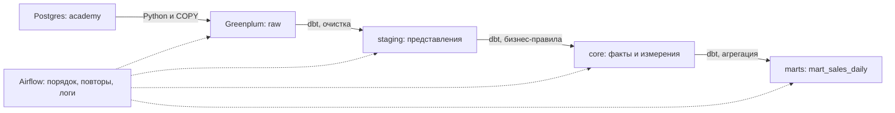
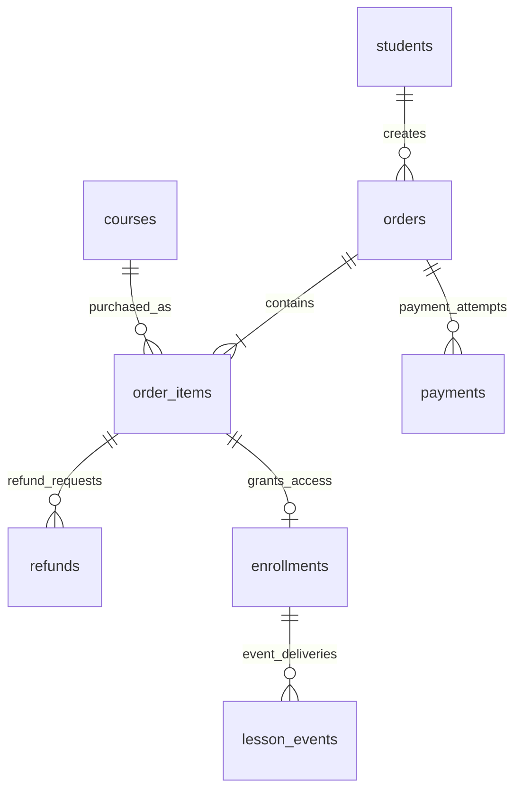
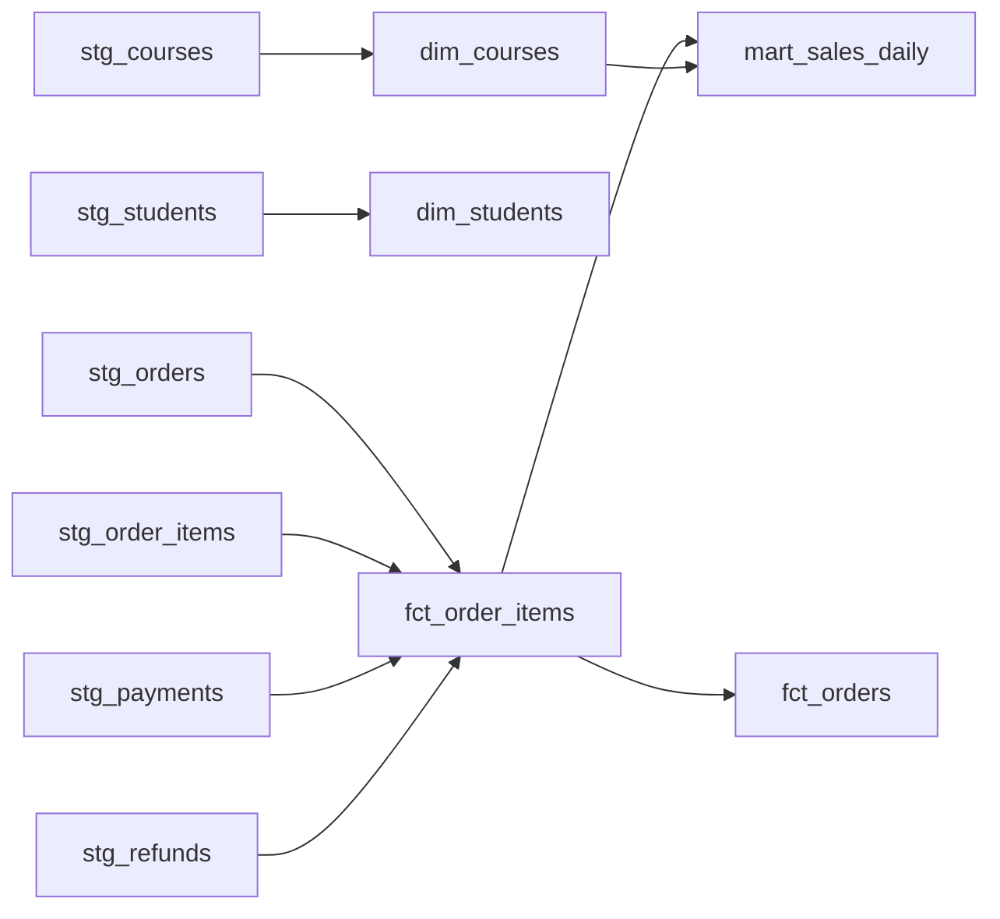

# Сценарий видео: от установки программ до витрины Greenplum

**Формат:** подробный разбор примерно на 130–150 минут: установка программ и первый запуск, затем путь данных с выполнением запросов. Скачивание и перезагрузки вырезаем при монтаже; показываем ввод команды и её результат. Установка для одной ОС занимает отдельную главу, варианты для остальных ОС — отдельные фрагменты с таймкодами. Основы Airflow и dbt уже разобраны в других видео: здесь показываем их место в конкретном DWH.

**Результат для зрителя:** установить Git, VS Code, DBeaver и Docker, скачать проект, запустить стенд, подключиться к обеим базам, проследить один заказ через все слои, объяснить итоговую сумму, изменить источник и проверить повторный расчёт. Весь выпуск посвящён готовой `marts.mart_sales_daily`. Решения двух самостоятельных заданий сюда не включены.

## Как пользоваться сценарием

У каждой главы есть цель, файлы для показа, запросы и реплики. Реплики можно пересказать своими словами. Числа ниже получены на исходном наборе данных из репозитория.

**Порядок записи:** [глава 0 — установка и запуск с нуля](#setup-from-zero), затем главы 1–12. Раздел подготовки ниже предназначен автору для репетиции. Зритель начинает с установки программ; подключения, терминал и готовые таблицы впервые появляются у него прямо в кадре.

Два файла с пронумерованными SQL-блоками:

- [video_source_queries.sql](video_source_queries.sql): **PG01–PG11**, выполнять в Postgres, база `postgres`.
- [video_warehouse_queries.sql](video_warehouse_queries.sql): **GP01–GP16**, выполнять в Greenplum, база `dwh`.

В DBeaver выделяй нужный блок и выполняй его отдельно. В файлах только чтение; изменение данных запускается отдельной командой в главе 11. Оба файла также можно выполнить целиком из терминала:

```bash
docker compose exec -T client-postgres psql -U postgres -d postgres -v ON_ERROR_STOP=1 < docs/video_source_queries.sql
bash scripts/gp_sql.sh < docs/video_warehouse_queries.sql
```

На Windows все команды проекта выполняются в Ubuntu WSL2, как описано в [README](../README.md).

## Подготовка автора до записи — репетиция

Сначала пройди сценарий целиком на своей ОС. Для съёмки установки используй отдельную учебную среду либо запиши реальные шаги первой установки. На уже настроенной машине показывай проверку версии и объясняй, что программа установлена. Рабочий Docker ради кадра переустанавливать не требуется.

До записи проверь обычное клонирование репозитория с GitHub: в новой папке должны быть `client-postgres-init/01_academy.sql`, `greenplum/01_raw.sql` и `airflow/dags/dag_academy_dwh.py`.

1. Выполни запуск из README и дождись результата проверки:

   ```bash
   docker compose --profile dwh up --build --detach --wait --wait-timeout 600
   docker compose exec -T airflow-scheduler python /opt/airflow/scripts/smoke_test.py --initial-only
   ```

2. Проверь, что показано **400 заказов и 7 158 110 ₽**. Если ранее применял `demo_changes.sql`, будет 401 заказ. Для повторения исходного сценария сначала сохрани нужную работу и выполни сброс ниже.
3. Подготовь два подключения DBeaver:

   | Название подключения | Host | Port | Database | User / Password |
   |---|---|---:|---|---|
   | `01 — Источник Postgres` | localhost | 5051 | postgres | postgres / postgres |
   | `02 — DWH Greenplum` | localhost | 5433 | dwh | gpadmin / gpadmin |

4. Открой [Airflow](http://localhost:8080), вход `airflow` / `airflow`, DAG `academy_dwh`. Должен быть успешный автоматический запуск.
5. В редакторе открой корень репозитория и файлы из карты ниже. Увеличь шрифт SQL и кода; скрывай длинные результаты перед следующим запросом.
6. Приготовь вкладки `PG03–PG06` и `GP08–GP13`: это основной путь заказа №308. Не меняй этот заказ во время съёмки.

**Сброс только этого учебного стенда:** следующие команды удаляют его базы и историю Airflow. Для обычного запуска они не нужны.

```bash
docker compose --profile dwh down --volumes
docker compose --profile dwh up --build --detach --wait --wait-timeout 600
docker compose exec -T airflow-scheduler python /opt/airflow/scripts/smoke_test.py --initial-only
```

В репетиции можно заранее скачать образы. В самом видео покажи полный путь главы 0: установку, клонирование, запуск, создание подключений и проверки. Паузы загрузки можно сократить; результат каждого шага должен остаться в кадре.

## Карта выпуска

| Длительность после монтажа | Глава | Что зритель должен понять |
|---|---|---|
| 30–45 минут | 0. Установка и первый запуск | Откуда взять программы, куда вводить команды, как получить работающий стенд |
| 4 минуты | 1. Результат и вопрос бизнеса | Что считает витрина и зачем она нужна |
| 6 минут | 2. Системы и слои | Где источник, кто запускает работу, где считаются данные |
| 12 минут | 3. Данные и заказ №308 | Сущности, детализация, оплата, скидка, возврат |
| 7 минут | 4. Запуск и библиотеки | Откуда берутся данные, DAG, подключения и зависимости |
| 9 минут | 5. MPP и распределение | Координатор, сегменты, ключ распределения, Motion |
| 15 минут | 6. DAG и загрузчик | Как восемь таблиц попадают в raw одним снимком |
| 7 минут | 7. Очистка staging | Что меняем в строках и что сохраняем |
| 12 минут | 8. Факты и измерения core | Как получить правильные деньги без размножения строк |
| 8 минут | 9. Витрина | Как позиции превращаются в день × курс |
| 8 минут | 10. Проверки и сбой | Почему зелёного SQL недостаточно и как работает откат |
| 12 минут | 11. Изменения и историчность | Текущий снимок, SCD Type 1, повторный запуск |
| 4 минуты | 12. Итоги и практика | Что повторить самому, как остановить стенд и продолжить завтра |

Таймкоды для описания YouTube поставь после монтажа: продолжительность установки зависит от ОС и сети.

<a id="setup-from-zero"></a>

## 0. От чистого компьютера до работающего стенда

### 0.1. Открывающая реплика и четыре программы

**На экране:** браузер с репозиторием, затем таблица ниже. Стенд пока не запускаем.

**Сказать:**

> Сегодня соберём учебное хранилище онлайн-школы. Начнём с установки программ, скачаем проект и запустим его. Потом откроем исходные данные и проследим путь заказа до витрины продаж. Все команды есть в репозитории, поэтому видео можно ставить на паузу и повторять шаги.
>
> Про Airflow и dbt уже есть отдельные видео. Здесь разберём, как связать их с двумя базами и получить проверяемый бизнес-результат.

| Что устанавливаем | Зачем это зрителю | Как проверим |
|---|---|---|
| Git | Скачать файлы репозитория | `git --version` |
| Visual Studio Code | Открывать код, README и терминал в одном окне | Открывается папка проекта |
| DBeaver Community | Подключаться к базам и выполнять SQL | Два успешных подключения |
| Docker Desktop или Docker Engine | Запустить базы и Airflow, собрать окружение dbt | `docker info`, затем Compose |

**Произнеси до установки:** для комфортного повторения рекомендуются 16 ГБ оперативной памяти на компьютере, 4 CPU и 8 ГБ памяти для Docker, от 20 ГБ свободного места. При первой установке нужен интернет. Базы, Python, Airflow и dbt установятся внутри контейнеров по файлам проекта.

Если программа уже есть, покажи её проверку и переходи к следующей. Версии настольных приложений могут отличаться от видео; версии компонентов самого стенда заданы в репозитории.

### 0.2. Где вводить команды

**На экране:** открой терминал через меню приложений; увеличь шрифт.

| ОС | Что открыть для установки | Где затем выполнять команды проекта |
|---|---|---|
| macOS | Spotlight → Terminal / Терминал | Terminal, позже Terminal → New Terminal в VS Code |
| Linux | Приложение Terminal | Bash, позже встроенный терминал VS Code |
| Windows 10/11 | Сначала PowerShell от администратора для WSL | Ubuntu из меню «Пуск», позже терминал VS Code в режиме WSL |

**Сказать:**

> Терминал — окно, в котором мы запускаем команды. Вставляй команду и нажимай Enter. Если в примере несколько самостоятельных команд, выполняй их по очереди и проверяй результат. Символы приглашения вроде `$` и имя пользователя копировать не нужно.
>
> Когда команда просит пароль через `sudo`, ввод может вообще не отображаться. Введи пароль пользователя этой системы и нажми Enter.

На Windows покажи момент смены окна: команды `wsl ...` вводим в PowerShell, а `sudo apt ...`, `git ...` и `docker compose ...` — в Ubuntu. Название выбранного терминала должно быть видно в кадре. Зритель проходит только вариант своей ОС.

### 0.3. Устанавливаем Git

#### macOS

1. В Terminal выполни:

   ```bash
   git --version
   ```

2. Если появилось окно установки Command Line Tools, выбери установку и дождись завершения. Если Git отсутствует, а окно не появилось, вызови его командой:

   ```bash
   xcode-select --install
   ```

3. Снова выполни `git --version`. На экране должна появиться строка с версией Git. Этот способ указан на [странице Git для macOS](https://git-scm.com/install/mac).

#### Linux — Ubuntu

Открой терминал и выполни:

```bash
sudo apt-get update
sudo apt-get install -y git
git --version
```

Для другого дистрибутива используй его пакетный менеджер по [инструкции Git для Linux](https://git-scm.com/install/linux).

#### Windows 10/11 — сначала WSL2, затем Git в Ubuntu

**На экране:** «Пуск» → PowerShell → «Запуск от имени администратора».

```powershell
wsl --install -d Ubuntu
```

Перезагрузи компьютер, если установщик попросит. Открой **Ubuntu** из «Пуска», дождись её настройки, задай Linux-логин и пароль. Этот пароль используется для `sudo` внутри Ubuntu. Если Ubuntu уже установлена, повторная установка не нужна.

Вернись в PowerShell:

```powershell
wsl --update
wsl --set-default-version 2
wsl -l -v
```

У Ubuntu в колонке `VERSION` должно быть **2**. Если там `1`, выполни `wsl --set-version Ubuntu 2`. Имя дистрибутива бери из вывода `wsl -l -v`. Порядок установки — в [документации Microsoft](https://learn.microsoft.com/en-us/windows/wsl/install).

Теперь **открой Ubuntu** и установи Git:

```bash
sudo apt-get update
sudo apt-get install -y git
git --version
```

**Сказать:**

> Дальше проект будет лежать в Ubuntu, и Git мы используем оттуда. В Windows остаются окна VS Code, DBeaver, браузера и Docker Desktop. Для скачивания этого публичного проекта достаточно команды clone; регистрацию в GitHub и SSH-ключи этот шаг не требует.

**Контрольная точка:** в терминале своей рабочей среды зритель видит версию Git.

### 0.4. Устанавливаем и открываем VS Code

**На экране:** [официальная страница Visual Studio Code](https://code.visualstudio.com/Download). Выбираем обычную стабильную версию для своей ОС и процессора.

| ОС | Действия в кадре |
|---|---|
| macOS | Скачай сборку Apple Silicon или Intel согласно «Об этом Mac». Открой образ, перенеси приложение в Applications и запусти. Для команды `code` открой палитру `Cmd+Shift+P`, найди `Shell Command: Install 'code' command in PATH`, выполни и заново открой Terminal. [Инструкция macOS](https://code.visualstudio.com/docs/setup/mac) |
| Windows | Скачай User Installer, запусти установку, оставь включённым добавление в PATH и открой VS Code. [Инструкция Windows](https://code.visualstudio.com/docs/setup/windows) |
| Ubuntu | Скачай `.deb` для своей архитектуры и открой через установщик приложений. Если установщик не открывается, перейди в папку загрузок и выполни `sudo apt install ./code_*.deb`, оставив в ней один скачанный пакет VS Code. [Инструкция Linux](https://code.visualstudio.com/docs/setup/linux) |

**Дополнение для Windows:** в VS Code открой Extensions, найди **WSL**, издатель **Microsoft**, и установи расширение. Сам редактор устанавливается в Windows. Позже команда `code .` из Ubuntu откроет папку через WSL; при первом запуске загрузится серверная часть редактора. Это штатный шаг. [Инструкция VS Code + WSL](https://code.visualstudio.com/docs/remote/wsl).

**Сказать:**

> В VS Code мы будем читать файлы проекта и вводить команды в терминале. Запросы к базам будем выполнять в DBeaver. Сейчас достаточно установить редактор; папку откроем после клонирования.

**Контрольная точка:** открывается окно VS Code. На Windows установлено расширение WSL. Дополнительные расширения для Python, Docker или dbt для запуска стенда не требуются.

### 0.5. Устанавливаем DBeaver Community

**На экране:** [загрузка DBeaver Community](https://dbeaver.io/download/). Выбираем Community и пакет для своей ОС/процессора.

1. **Windows:** скачай установщик, пройди его шаги и запусти DBeaver из «Пуска».
2. **macOS:** открой `.dmg`, перенеси DBeaver в Applications и запусти.
3. **Ubuntu:** скачай `.deb`, открой установщиком пакетов. Либо в каталоге со скачанным пакетом выполни `sudo apt install ./dbeaver-ce_*.deb`; в каталоге должен быть один подходящий пакет.

Java уже включена в обычные дистрибутивы DBeaver с официальной страницы. При первом открытии откажись от создания демонстрационной базы, если программа это предлагает: учебные базы появятся после запуска Compose.

**Сказать:**

> DBeaver — клиент базы данных. Он подключится к запущенному серверу и отправит туда SQL. Сейчас установили клиент; сами серверы запустим следующим шагом.

**Контрольная точка:** открывается главное окно DBeaver. Подключения создадим в разделе 0.12.

### 0.6. Устанавливаем Docker

**Сказать:**

> Образ — подготовленное окружение с программой и её зависимостями. Контейнер — запущенный экземпляр такого окружения. В проекте несколько сервисов; Compose запустит их вместе и свяжет сетью. Базы будут сохранять данные в отдельных Docker volumes, то есть постоянных томах.

#### macOS — Docker Desktop

1. Открой [установку Docker Desktop для Mac](https://docs.docker.com/desktop/setup/install/mac-install/). Выбери Apple Silicon или Intel согласно процессору.
2. Скачай `.dmg`, открой его, перенеси Docker в Applications и запусти.
3. Пройди первоначальную настройку. Дождись, пока приложение покажет работающий Engine.
4. В **Settings → Resources** выдели для стенда 4 CPU и 8 ГБ памяти, примени настройки. Это рекомендация для компьютера с 16 ГБ RAM и более. [Настройки ресурсов Docker](https://docs.docker.com/desktop/settings-and-maintenance/settings/).

Если зритель уже использует рабочую Colima с Docker и Compose, он может перейти к проверкам раздела 0.7. На машине автора предыдущие прогоны выполнены именно через Colima; установка Docker Desktop здесь описывает отдельный путь для нового зрителя.

#### Windows 10/11 — Docker Desktop с WSL2

WSL2 и Ubuntu уже подготовлены в разделе 0.3.

1. Открой [страницу Docker Desktop для Windows](https://docs.docker.com/desktop/setup/install/windows-install/), проверь требования к своей версии Windows и скачай установщик.
2. При установке выбери WSL2 backend, если этот выбор предлагается. Выполни запрошенную перезагрузку и запусти Docker Desktop.
3. В **Settings → General** проверь **Use the WSL 2 based engine**.
4. В **Settings → Resources → WSL Integration** включи свою Ubuntu и примени изменения. Если раздела нет, проверь режим **Linux containers**. [Интеграция Docker с WSL2](https://docs.docker.com/desktop/features/wsl/).
5. Открой новое окно **Ubuntu**. Docker-команды далее вводи в нём. Docker Engine внутри этой Ubuntu отдельно устанавливать не требуется.

**Про Windows 10:** возможность установки зависит от сборки и срока её поддержки. Перед записью сверяй [актуальные требования Docker](https://docs.docker.com/desktop/setup/install/windows-install/); одна надпись «Windows 10» не подтверждает совместимость. Для Windows 11 также нужны подходящая сборка и включённая виртуализация.

В режиме WSL2 память и CPU ограничиваются настройками WSL. Если `docker info` показывает слишком мало памяти для стенда, проверь лимиты WSL по [инструкции Microsoft](https://learn.microsoft.com/en-us/windows/wsl/wsl-config#main-wsl-settings). Рекомендуемый доступный объём для стенда — 8 ГБ. На этом шаге ещё нет запущенных учебных контейнеров.

<details>
<summary>Если нужно поднять лимит WSL до 8 ГБ на компьютере с 16 ГБ RAM и более</summary>

В PowerShell открой файл настроек пользователя Windows:

```powershell
notepad "$env:USERPROFILE\.wslconfig"
```

Если файла ещё нет, создай его. Добавь или исправь параметры в секции `[wsl2]`, сохрани остальные существующие настройки:

```ini
[wsl2]
memory=8GB
processors=4
```

Сохрани именно `.wslconfig`, без расширения `.txt`. Сохрани работу в других WSL-окнах и закрой Docker Desktop: следующая команда остановит все работающие WSL-дистрибутивы.

```powershell
wsl --shutdown
```

Снова запусти Docker Desktop, открой Ubuntu и проверь `docker info`. Изменённые лимиты применяются при новом запуске WSL.

</details>

#### Linux — полный пример для чистой Ubuntu 22.04/24.04

Эти команды относятся к **самостоятельной Ubuntu**, установленной на компьютере или в VM. Зритель с Windows использует предыдущий вариант с Docker Desktop. Для Fedora, Debian и других систем открой соответствующий раздел [установки Docker Engine](https://docs.docker.com/engine/install/).

Если Docker уже работает, перейди к 0.7. Для чистой Ubuntu подключи официальный репозиторий пакетов:

```bash
sudo apt-get update
sudo apt-get install -y ca-certificates curl
sudo install -d -m 0755 /etc/apt/keyrings
sudo curl -fsSL https://download.docker.com/linux/ubuntu/gpg -o /etc/apt/keyrings/docker.asc
sudo chmod a+r /etc/apt/keyrings/docker.asc
```

Следующий блок вставь **целиком**, включая последнюю строку `EOF`. Он запишет адрес репозитория, версию Ubuntu и архитектуру компьютера:

```bash
. /etc/os-release
sudo tee /etc/apt/sources.list.d/docker.sources > /dev/null <<EOF
Types: deb
URIs: https://download.docker.com/linux/ubuntu
Suites: ${UBUNTU_CODENAME:-$VERSION_CODENAME}
Components: stable
Architectures: $(dpkg --print-architecture)
Signed-By: /etc/apt/keyrings/docker.asc
EOF
```

Установи Engine, клиент, сборщик и Compose, затем запусти сервис:

```bash
sudo apt-get update
sudo apt-get install -y docker-ce docker-ce-cli containerd.io docker-buildx-plugin docker-compose-plugin
sudo systemctl enable --now docker
sudo usermod -aG docker "$USER"
```

Выйди из учётной записи Ubuntu и войди снова, чтобы применилось членство в группе. Дальнейшие команды `docker` выполняются обычным пользователем. Доступ к группе Docker даёт широкие права на этой машине. Шаги основаны на [установке для Ubuntu](https://docs.docker.com/engine/install/ubuntu/) и [настройке доступа пользователя](https://docs.docker.com/engine/install/linux-postinstall/).

### 0.7. Проверяем программы перед клонированием

**На экране:** один терминал нужной ОС. На Windows — Ubuntu.

```bash
git --version
docker version
docker compose version
docker info
```

| Команда | Что показать зрителю |
|---|---|
| `git --version` | Строка с установленной версией Git |
| `docker version` | Обе части: Client и Server; значит клиент связался с движком |
| `docker compose version` | Современный плагин Compose, версия 2.20+; более новые основные версии также подходят |
| `docker info` | Работающий Server, `OSType: linux`, доступные CPU и память |

**Сказать:**

> Установка Docker и запуск его движка — два отдельных шага. Если Client есть, а Server отвечает ошибкой, сначала запусти Docker Desktop или сервис Docker Engine. Когда эти проверки проходят, можно запускать проект.

В проекте используется команда **`docker compose`** с пробелом. До успешной проверки движка к сборке не переходим.

### 0.8. Клонируем репозиторий

**На экране:** страница [репозитория](https://github.com/DE-Infrastructure/localstand_guide_de), README, кнопка **Code → HTTPS**. Покажи URL, который используешь в команде.

В терминале:

```bash
mkdir -p ~/projects
cd ~/projects
git clone https://github.com/DE-Infrastructure/localstand_guide_de.git
cd localstand_guide_de
pwd
ls
```

**Разобрать по строкам:**

- `mkdir -p` создаёт папку для проектов; существующая папка подходит.
- `~` — домашний каталог текущего пользователя.
- `cd` меняет рабочую папку терминала.
- `git clone` скачивает репозиторий в новую папку `localstand_guide_de`.
- `pwd` показывает, где сейчас находится терминал; `ls` перечисляет файлы.

На Windows ожидаем путь `/home/<твой-логин>/projects/localstand_guide_de`. Код хранится в файловой системе Ubuntu. Рекомендация по хранению кода в WSL приведена в [документации Docker](https://docs.docker.com/desktop/features/wsl/best-practices/).

На macOS путь будет начинаться с `/Users/<твой-логин>/projects/`, на обычной Ubuntu — с `/home/<твой-логин>/projects/`. Вместо угловых скобок терминал покажет реальное имя пользователя; вводить эти примеры путей вручную не нужно.

В списке должны быть **`docker-compose.yaml`**, **`Dockerfile`**, **`README.md`**, каталоги **`airflow`**, **`client-postgres-init`**, **`greenplum`**, **`dbt_project`**, **`docs`**, **`scripts`**.

**Сказать:**

> Сейчас мы скачали код и SQL, который создаст учебные данные. Docker-образы будут загружаться следующим шагом и займут основной объём. Репозиторий не содержит выгрузку базы на гигабайты.

Если Git пишет, что папка уже существует, остановись и посмотри её содержимое: возможно, проект уже скачан. Для продолжения перейди в существующую папку; повторять clone внутри неё не нужно.

### 0.9. Открываем проект и терминал в VS Code

Находясь в корне скачанного проекта, выполни:

```bash
code .
```

Точка означает «текущая папка». В VS Code слева должно появиться дерево **всего репозитория**. Если редактор предлагает доверять авторам папки, проверь, что это только что скачанный учебный проект, и подтверди доверие для работы с ним.

На Windows дождись настройки расширения: в левом нижнем углу должен быть индикатор **WSL: Ubuntu**. Если `code` не найден, перезапусти терминал после установки VS Code; проверь PATH и расширение WSL. Через палитру VS Code также можно выполнить **WSL: Connect to WSL using Distro**, выбрать Ubuntu, затем **File → Open Folder** и папку проекта. На macOS проверь установку команды `code` из раздела 0.4.

Открой **Terminal → New Terminal**, затем:

```bash
pwd
ls docker-compose.yaml
```

**Контрольная точка:** терминал находится в корне репозитория и видит Compose-файл. Для macOS/Linux также можно открыть папку через **File → Open Folder**.

**Показать в дереве без подробного разбора:**

| Файл или папка | Реплика |
|---|---|
| `README.md` | «Здесь короткая инструкция запуска и адреса подключений» |
| `docker-compose.yaml` | «Здесь описано, какие сервисы запустятся вместе» |
| `client-postgres-init/01_academy.sql` | «Здесь создаются исходные таблицы и все учебные данные» |
| `airflow/dags/dag_academy_dwh.py` | «Это уже готовый DAG: Airflow увидит этот файл» |
| `dbt_project/models` | «Здесь SQL слоёв и нашей витрины» |
| `docs/video_source_queries.sql`, `docs/video_warehouse_queries.sql` | «Это запросы, которые будем выполнять по ходу видео» |

### 0.10. Выбираем набор сервисов и запускаем Docker Compose

**На экране:** терминал VS Code в корне проекта. Docker уже работает.

**Сначала объяснить выбор:**

> Можно запускать стенд по частям. Обычная команда Compose поднимет Airflow, его служебную базу и окружение dbt. Когда дойдём до источника, добавим профиль source. Для всего пути до витрины выбираем профиль dwh: он поднимет также Postgres с учебными данными и Greenplum.

| Набор | Команда | Что показываем |
|---|---|---|
| Airflow + dbt | `docker compose up --build --detach --wait --wait-timeout 600` | Интерфейс Airflow, scheduler и установленный dbt |
| Airflow + dbt + источник | `docker compose --profile source up --build --detach --wait --wait-timeout 600` | Дополнительно Postgres с восемью таблицами `academy` |
| Полный DWH | `docker compose --profile dwh up --build --detach --wait --wait-timeout 600` | Дополнительно Greenplum, включение DAG и сборка витрины |

**Вариант для поэтапной записи:** сначала выполни базовый запуск из первой строки. После его завершения открой Airflow, покажи DAG `academy_dwh` на паузе и проверь dbt:

```bash
docker compose exec -T airflow-scheduler /opt/dbt-venv/bin/dbt --version
```

Объясни, что dbt установлен внутри образа Airflow и отдельного постоянного контейнера для него нет. В базовом наборе Greenplum и бизнес-источник не запускаются; витрина ещё не строится. DAG получает паузу при первой регистрации, чтобы не обращаться к базам раньше времени. Если уже работал с сохранённой историей Airflow, её состояния сохраняются.

Чтобы отдельно показать появление исходных данных, добавь профиль `source` из второй строки и подключись к `localhost:5051`: Postgres сам заполнит `academy` при первом создании своего тома. Greenplum на этом шаге ещё отсутствует. Для основного пути этого выпуска дальше добавляем весь DWH:

```bash
docker compose --profile dwh up --build --detach --wait --wait-timeout 600
```

Команда подходит и для первого запуска, и для расширения уже работающего базового набора. Если снимаешь непрерывную установку сразу всего DWH, выполни только эту команду; промежуточные запуски необязательны.

**Сказать до Enter:**

> Эта команда скачает нужные образы, соберёт окружение Airflow с dbt и запустит сервисы. При первом запуске ждать придётся дольше. Оставляем команду работать, пока она не вернёт управление или не покажет ошибку.

| Часть команды | Что означает |
|---|---|
| `--profile dwh` | Включить дополнительно источник, Greenplum и сервис включения DWH-DAG |
| `up` | Создать и запустить сервисы выбранного набора |
| `--build` | Собрать образ, для которого в проекте есть Dockerfile |
| `--detach` | Оставить контейнеры работать в фоне |
| `--wait` | Дождаться состояния running/healthy у запускаемых сервисов |
| `--wait-timeout 600` | Дать сервисам до 600 секунд на готовность; это не обещание закончить скачивание, сборку и DAG за десять минут |

**Пока идёт запуск, коротко объяснить автоматические действия:**

1. Docker создаёт сеть, контейнеры и постоянные тома для данных.
2. Postgres при первом создании пустой базы выполняет `client-postgres-init/01_academy.sql`: создаёт `academy` и восемь таблиц, заполняет их данными.
3. Greenplum поднимает координатор, два primary-сегмента и базу `dwh`.
4. `airflow-init` готовит служебную базу и пользователя `airflow`.
5. Scheduler читает смонтированный файл DAG. При первой регистрации DAG стоит на паузе. Одноразовый `dwh-init` ждёт готовности баз и scheduler, затем включает `academy_dwh`.
6. Расписание `@once` создаёт первый автоматический запуск: DAG загружает raw, запускает dbt по слоям, выполняет тесты и проверяет итоговые суммы.

**Сказать:**

> Исходные данные генерируются локальным SQL. DAG приходит с репозиторием, а настройки его подключений переданы через Compose. После запуска нам остаётся дождаться результата и проверить его. Сейчас посмотрим отдельно на контейнеры и на готовность данных.

### 0.11. Убеждаемся, что стенд и первая загрузка готовы

```bash
docker compose --profile dwh ps -a
```

Покажи строки по **именам сервисов**: сгенерированные полные имена контейнеров могут выглядеть иначе.

| Сервис | Ожидаемое состояние |
|---|---|
| `client-postgres` | Up, healthy |
| `greenplum` | Up, healthy |
| `airflow-postgres` | Up, healthy |
| `airflow-webserver` | Up, healthy |
| `airflow-scheduler` | Up, healthy |
| `airflow-init` | Exited (0): одноразовая инициализация Airflow завершилась успешно |
| `dwh-init` | Exited (0): базы готовы, DWH-DAG включён |

Теперь выполни:

```bash
docker compose exec -T airflow-scheduler python /opt/airflow/scripts/smoke_test.py --initial-only
```

**Объяснить:** `exec` запускает команду в уже работающем контейнере `airflow-scheduler`; Python берётся из контейнера. `-T` отключает выделение псевдотерминала. `--initial-only` ждёт автоматический DAG и проверяет результат без создания дополнительных запусков.

**Что оставить в кадре:** `PASS` для автоматического запуска, сообщение о двух работающих primary-сегментах и контрольные значения:

| Показатель в выводе | Исходное значение |
|---|---:|
| `students` | 200 |
| `courses` | 6 |
| `orders` | 400 |
| `paid_orders` | 320 |
| `items` | 800 |
| `raw_enrollments` | 640 |
| `raw_events` | 4223 |
| `net_rub` | 7 158 110 ₽ |

**Сказать:**

> Healthy означает, что сервис готов к работе. Проверка DAG подтверждает следующий уровень: загрузка уже прошла и витрина содержит ожидаемые данные. Именно этот результат нам нужен перед разбором.

Если ранее применял демонстрационные изменения, исходные числа будут другими. Используй раздел подготовки автора для возврата к исходному набору; для обычного продолжения работы тома сохраняем.

### 0.12. Создаём оба подключения в DBeaver

**На экране:** DBeaver. Создай первое подключение через **Database → New Database Connection**, выбери **PostgreSQL**, перейди к параметрам. В русской локализации названия меню переведены. [Мастер подключения DBeaver](https://dbeaver.com/docs/dbeaver/Create-Connection/).

| Поле | Источник Postgres | DWH Greenplum |
|---|---|---|
| Название подключения | `01 — Источник Postgres` | `02 — DWH Greenplum` |
| Драйвер | PostgreSQL | Greenplum; PostgreSQL также подходит для SQL этого гайда |
| Host | `localhost` | `localhost` |
| Port | `5051` | `5433` |
| Database | `postgres` | `dwh` |
| Username | `postgres` | `gpadmin` |
| Password | `postgres` | `gpadmin` |
| SSL | Выключен для локального стенда | Выключен для локального стенда |
| SSH tunnel | Не используется | Не используется |

**Для первого подключения:**

1. Введи значения колонки Postgres. Пароль можно сохранить для этого локального стенда.
2. Нажми **Test Connection**. Если DBeaver предлагает скачать JDBC-драйвер, нажми **Download** и дождись завершения. Драйвер позволяет клиенту общаться с сервером; при его первой загрузке нужен интернет.
3. Покажи успешный результат и нажми **Finish**. Переименуй подключение через его контекстное меню, если имя не было задано в мастере.
4. Раскрой подключение → базу `postgres` → **Schemas → academy → Tables**. Если узел базы скрыт настройками навигатора, начинай со Schemas. Покажи восемь таблиц.

**Для второго:** повтори мастер со значениями Greenplum. Проверь соединение, сохрани и раскрой схемы базы `dwh`: `raw`, `staging`, `core`, `marts`, `etl`. Представления staging находятся в узле **Views**, физические таблицы остальных слоёв — в **Tables**. После завершения DAG при необходимости обнови дерево через **Refresh**.

**Разобрать адрес:**

> Host — адрес компьютера с сервером, port — порт подключения. С нашего компьютера обе базы доступны через localhost, но на разных портах: 5051 и 5433. Database выбирает базу внутри сервера. Схема — следующий уровень внутри базы; `academy` вводить в поле Database не нужно.

На Windows DBeaver открыт в Windows и тоже использует `localhost`. Изнутри контейнеров Airflow обращается к сервисам по другим адресам:

| Откуда подключаемся | Postgres | Greenplum |
|---|---|---|
| DBeaver на компьютере | `localhost:5051`, база `postgres` | `localhost:5433`, база `dwh` |
| Airflow внутри Docker | `client-postgres:5432`, база `postgres` | `greenplum:5432`, база `dwh` |

Служебный `airflow-postgres:5432` хранит состояния Airflow. Его порт на компьютер не опубликован; для разбора бизнес-данных используем два подключения выше. Порты Greenplum-сегментов отдельно в DBeaver не вводим: клиент подключается к координатору, который распределяет работу.

### 0.13. Выполняем первые SQL-запросы

**На экране:** выбери подключение `01 — Источник Postgres`, через его контекстное меню открой **SQL Editor → New SQL Script**. Перед запуском покажи имя активного подключения в редакторе.

```sql
select current_database(), current_user;
select count(*) as source_orders from academy.orders;
```

Выдели первый запрос, затем выбери действие **Execute SQL Statement** на панели SQL-редактора. Повтори со вторым. Ожидаются база `postgres`, пользователь `postgres`, затем **400** заказов.

Теперь создай отдельный SQL-редактор для `02 — DWH Greenplum`:

```sql
select current_database(), current_user;
select count(*) as raw_orders from raw.orders;
select count(*) as mart_rows,
       sum(net_sales_rub) as net_sales_rub
from marts.mart_sales_daily;
```

Выполняй запросы по одному. Ожидаются база `dwh`, пользователь `gpadmin`, **400** строк raw, **144** строки витрины и **7 158 110 ₽**. Число знаков после запятой зависит от отображения numeric в клиенте.

**Сказать:**

> Мы проверили два разных сервера. В источнике уже есть заказы, в Greenplum есть их копия в raw и готовая витрина. Теперь можно разбирать, каким кодом получены эти значения.

Для следующих глав открой в VS Code `docs/video_source_queries.sql` и `docs/video_warehouse_queries.sql`. Копируй нужный пронумерованный блок в SQL-редактор соответствующего подключения DBeaver. Этот способ одинаков для macOS, Linux и Windows: DBeaver не нужно отдельно настраивать доступ к файлам внутри WSL.

Каждый раз проговаривай базу перед выполнением: «PG — источник Postgres», «GP — Greenplum». Ошибка `relation ... does not exist` часто означает, что запрос ушёл в другое подключение.

### 0.14. Открываем Airflow и находим уже выполненный DAG

1. В обычном браузере открой [http://localhost:8080](http://localhost:8080).
2. На странице входа введи логин **`airflow`**, пароль **`airflow`**.
3. Найди **`academy_dwh`** в списке DAG и открой его. Переключатель должен показывать, что DAG включён.
4. В **Grid** выбери успешный автоматический запуск. В **Graph** покажи цепочку задач:

   ```text
   load_raw → dbt_staging → dbt_core → dbt_marts → dbt_test_all → verify_marts
   ```

5. Открой задачу **`load_raw`**, вкладку **Logs**: покажи количества перенесённых строк. Затем открой лог **`dbt_test_all`**, где все 72 теста завершились успешно, и лог **`verify_marts`** с итоговыми проверками.

**Сказать:**

> DAG уже лежал в репозитории и подключён к контейнеру через Compose. Scheduler увидел его; после готовности баз сервис `dwh-init` включил DAG, и расписание создало первый запуск. Код переноса и SQL-модели будем читать по порядку. Ручной запуск пригодится позже, когда изменим источник.

Если в названии первого запуска видна дата `2026-01-01`, это заданная DAG логическая дата, а не обязательно день записи видео. Загрузчик читает все восемь таблиц и не фильтрует их по этой дате.

На этом шаге достаточно показать наличие успешного запуска и логов. Подробный разбор кода начинается в главе 6.

### 0.15. Если первый запуск остановился на ошибке

**Правило для видео:** сначала показать сообщение, затем команду диагностики и исправление. После исправления повторить ту же команду запуска.

```bash
docker compose --profile dwh ps -a
docker compose --profile dwh logs --tail 100 airflow-init dwh-init greenplum airflow-scheduler airflow-webserver client-postgres
```

| Симптом | Что проверить и сделать |
|---|---|
| `git: command not found` | Git должен быть установлен в том терминале, где вводится команда; на Windows проверь Git в Ubuntu |
| `code: command not found` | Перезапусти терминал; на Mac добавь команду в PATH, на Windows проверь установленный VS Code и расширение WSL |
| `docker: command not found` в Ubuntu WSL | Включи интеграцию именно этой Ubuntu в Docker Desktop и открой терминал заново |
| `Cannot connect to the Docker daemon` | Запусти движок; проверь `docker info` |
| `permission denied` для Docker socket на Linux | Заново войди в систему после добавления пользователя в группу Docker |
| `no configuration file provided` | Выполни `pwd`; перейди в каталог с `docker-compose.yaml` |
| `port is already allocated` | Найди другой сервис на указанном порту; останови его, если он сейчас не нужен, либо задай другой порт стенда в `.env` |
| Ошибка скачивания образа или Python-пакета | Проверь сеть и доступ к Docker Hub/PyPI, затем повтори команду; базы удалять не требуется |
| `Resource deadlock avoided` при чтении файла проекта на Mac | Ошибка наблюдалась при чтении файлов, ещё не скачанных из облака. Скачай папку целиком через Finder либо клонируй в локальный `~/projects` вне облачной синхронизации, затем перезапусти Docker/Colima |
| Таймаут или `unhealthy` | Посмотри лог проблемного сервиса; проверь память и свободное место. После исправления повтори запуск |
| `Exited (137)` / `OOMKilled` | Увеличь доступную Docker/WSL память и сократи нагрузку других программ |
| В DBeaver `Connection refused` | Убедись, что нужная БД healthy, проверь опубликованный порт в `docker compose ps`; попробуй `127.0.0.1` вместо `localhost` |
| DBeaver не может скачать драйвер | Это загрузка библиотеки клиента; проверь доступ к адресу из ошибки и повтори Download |
| Нет Greenplum, порт 5433 недоступен | Проверь профиль: полный набор запускается командой с `--profile dwh` |
| DAG на паузе | В базовом наборе это ожидаемо; после полного запуска посмотри `docker compose --profile dwh logs dwh-init` |
| В Airflow задача красная | Открой Logs именно этой задачи; после исправления причины запусти DAG повторно и дождись результата |
| В DBeaver нет схем или таблиц | Дождись успешного DAG, проверь активную базу и обнови дерево; staging смотри в Views |

Если из-за недоступного SQL-файла уже упала инициализация Postgres-источника, одного повторного `up` может быть недостаточно: seed выполняется только на пустом томе. Сначала восстанови доступ к файлам. Для чистого учебного набора затем используй [сброс из раздела подготовки автора](#подготовка-автора-до-записи--репетиция), который удаляет базы стенда и историю Airflow.

**Пример изменения занятых портов:** если `.env` ещё нет, создай его командой `cp .env.example .env`. Если файл уже существует, открой его и измени нужные значения. Например:

```dotenv
SOURCE_PORT=15051
GREENPLUM_PORT=15433
AIRFLOW_PORT=18080
```

Повтори `docker compose --profile dwh up --build --detach --wait --wait-timeout 600`. При таких значениях DBeaver подключается к портам **15051/15433**, браузер — к **18080**; внутренние адреса контейнеров остаются прежними. Далее в сценарии указаны стандартные порты — зритель с `.env` подставляет свои.

После исправленного сбоя DAG можно проверить новый ручной запуск командой:

```bash
docker compose exec -T airflow-scheduler airflow dags trigger academy_dwh
```

Дождись его успеха в UI, затем выполни:

```bash
docker compose exec -T airflow-scheduler python /opt/airflow/scripts/verify_warehouse.py --expected baseline
```

`smoke_test.py --initial-only` проверяет именно первый автоматический запуск. Если тот завершился ошибкой, более поздний успешный ручной запуск не меняет его историю. Поэтому после такого исправления проверяем новый запуск и витрину отдельно. Удаление томов нужно только для осознанного возврата к чистому учебному набору.

### 0.16. Точка перехода к разбору DWH

**Оставить на экране четыре подтверждения:**

- В VS Code открыт репозиторий и виден `docker-compose.yaml`.
- В полном профиле пять постоянных сервисов healthy; `airflow-init` и `dwh-init` завершены с кодом 0.
- В DBeaver работают оба подключения: 400 заказов в источнике и raw, 144 строки витрины, итог 7 158 110 ₽.
- В Airflow успешный запуск `academy_dwh`, все шесть задач завершились успешно.

**Переход:**

> Стенд готов. Дальше разберём его на конкретной покупке: какие строки появились в источнике, как Airflow перенёс их в Greenplum, какие правила применил dbt и почему в витрине получилась именно такая сумма.

## 1. Разбираем результат: какой вопрос решает витрина

**На экране:** Greenplum, запрос **GP12**.

**Сказать:**

> У нас онлайн-школа. Студенты покупают курсы, иногда повторяют оплату, получают скидки и возвращают часть денег. Мы хотим видеть продажи по дням и курсам. Сегодня проследим путь конкретного заказа: от исходных строк до итоговой суммы в этой таблице.
>
> Одна строка здесь означает один курс за одну дату заказа. Сначала договоримся, что именно считаем. После этого посмотрим, как такая таблица получается автоматически.

На исходных данных за **14 февраля 2026** показать:

| Курс | Оплаченных заказов | Проданных позиций | После скидок, до возвратов | Возвраты | После возвратов |
|---|---:|---:|---:|---:|---:|
| Python для инженера данных | 5 | 5 | 47 520 ₽ | 4 455 ₽ | 43 065 ₽ |
| Проектирование DWH | 5 | 5 | 71 520 ₽ | 0 ₽ | 71 520 ₽ |

Объяснить, что готовая витрина позволяет читать результат обычным `SELECT`. На неё затем можно подключить BI. В этом выпуске конечный результат — проверенная таблица, BI-инструмент не требуется.

**Переход:** «Разберём, какие исходные строки дали эти суммы».

## 2. Роли систем и слоёв

**На экране:** эта схема и дерево проекта.



**Сказать:**

> Postgres изображает рабочую базу приложения онлайн-школы. Greenplum — отдельная база для аналитики. Airflow задаёт порядок действий и запускает задачи. Python переносит данные. dbt собирает SQL-модели и отправляет запросы в Greenplum. Сами JOIN и GROUP BY выполняет Greenplum.

Сразу объяснить три разных значения слова «таблица» в разговоре:

- **Таблица источника** отражает работу приложения: заказ, попытка оплаты, возврат.
- **Таблица DWH** хранит подготовленные данные для анализа.
- **Витрина** содержит показатели для определённого вопроса бизнеса.

| Схема Greenplum | На какой вопрос отвечает | Что в ней лежит |
|---|---|---|
| `raw` | Что мы получили из источника в последней загрузке? | Восемь таблиц с исходными значениями и метаданными загрузки |
| `staging` | Как привести значения к договорённому формату? | Шесть представлений: строки очищены, статусы нормализованы |
| `core` | Как описать студентов, курсы, заказы и продажи? | Два измерения и два факта |
| `marts` | Как ответить на конкретный аналитический вопрос? | Одна таблица продаж по дню и курсу |
| `etl` | Когда и сколько данных загрузили? | Журнал `load_audit` и таблица для блокировки загрузчика |

Схема здесь — пространство имён внутри базы `dwh`. `core.fct_orders` означает «таблица `fct_orders` в схеме `core`». Все перечисленные слои находятся в одной базе Greenplum.

**Термины коротко:** измерение описывает объект, например курс. Факт содержит измеримое событие или результат, например позицию заказа и её сумму. Детализация, или *grain*, отвечает на вопрос «что означает одна строка». Перед каждым JOIN будем проверять именно её.

## 3. Источник и сквозной пример

### 3.1. Какие сущности есть в школе

**Открыть:** [01_academy.sql](../client-postgres-init/01_academy.sql). Выполнить **PG01**, затем **PG02**.

| Таблица `academy` | Строк | Одна строка | Ключ и связи |
|---|---:|---|---|
| `students` | 200 | Студент | `student_id` |
| `courses` | 6 | Курс в каталоге | `course_id` |
| `orders` | 400 | Заказ | `order_id`, ссылка на студента |
| `order_items` | 800 | Курс в заказе | `order_item_id`, ссылки на заказ и курс |
| `payments` | 366 | Попытка оплаты заказа | `payment_id`, ссылка на заказ |
| `refunds` | 51 | Возврат по позиции заказа | `refund_id`, ссылка на позицию |
| `enrollments` | 640 | Зачисление на купленную позицию | `enrollment_id`, ссылка на позицию |
| `lesson_events` | 4 223 | Доставка события обучения | `delivery_id`; `event_id` обозначает логическое событие |



В SQL показать `PRIMARY KEY`, `REFERENCES` и `UNIQUE(order_id, course_id)`. Последнее означает, что один курс встречается в заказе один раз. В текущем наборе у каждого заказа две позиции.

**Сказать:**

> Заказ и оплата — разные сущности. У заказа может быть неудачная попытка оплаты, а затем успешная. Возврат связан с конкретной позицией: можно вернуть часть стоимости одного курса, сохранив второй.

Данные генерируются SQL через `generate_series`, фиксированные даты и арифметику по ID. Случайных значений и внешнего API нет, поэтому зритель получает те же примеры. Заказы относятся к январю–марту 2026. Даты выбраны для воспроизводимости; сегодняшний день компьютера на seed не влияет.

### 3.2. Проходим заказ №308 вручную

Выполнять **PG03 → PG04 → PG05 → PG06**, по одному блоку.

1. Заказ **308**, студент **197 — Михаил Студент 197**, дата **2026-02-14 08:00 UTC**. Исходный статус — `'PAID '` с пробелом.
2. В заказе два курса:

   | Позиция | Курс | Цена | Скидка | К оплате |
   |---|---|---:|---:|---:|
   | 3081 | Python | 9 900 ₽ | 990 ₽ | 8 910 ₽ |
   | 3082 | DWH | 14 900 ₽ | 1 490 ₽ | 13 410 ₽ |
   | Итого | | 24 800 ₽ | 2 480 ₽ | **22 320 ₽** |

3. В 08:05 попытка `3080` на 22 320 ₽ не прошла. В 08:15 оплата `3081` на ту же сумму прошла. Полученные деньги — **22 320 ₽**.
4. **19 февраля** обработан возврат **4 455 ₽** по позиции Python. Это половина её стоимости после скидки.
5. Результат заказа после возврата: **22 320 − 4 455 = 17 865 ₽**.

**Сказать:**

> Пока мы посчитали результат вручную. Дальше будем проверять, что код даёт те же 17 865 рублей. Если на каком-то шаге появилась другая сумма, мы уже знаем, где искать ошибку.

Деньги хранятся целым числом копеек: `2232000` означает `22 320 ₽`. В core расчёты остаются в копейках. Деление на `100.0` выполняется в витрине и демонстрационных запросах. Это сохраняет точность денежных операций.

### 3.3. Договор о бизнес-правилах

Этот блок проговорить **до** показа реализации.

| Правило | Как применяется в проекте |
|---|---|
| Цена продажи | Берём цену позиции `order_items`, затем вычитаем скидку этой позиции |
| Оплата | Учитываем только `succeeded`; `failed` не приносит денег |
| Полнота оплаты | Сумма успешных оплат должна совпадать с суммой заказа после скидок |
| Несколько успешных платежей | Складываем их на уровне заказа; итог должен покрывать заказ полностью |
| Частичная оплата или переплата | Финансовый тест завершает DAG с ошибкой; отдельной модели рассрочек здесь нет |
| Возврат | Вычитаем только `processed`; `requested` ещё не уменьшает продажи |
| Размер возврата | Не может превышать продажи соответствующей позиции |
| Дата витрины | Дата создания заказа в UTC |
| Поздний возврат | Меняет показатель даты первоначального заказа, даже если произошёл позже |
| Неоплаченные заказы | Сохраняются в core с нулевой суммой продаж; в витрину продаж не включаются |

Название `gross_kopecks` в этом проекте означает **продажи после скидок, до возвратов**. `net_kopecks` — после обработанных возвратов. Названия показателей читаем вместе с их определением.

**PG08:** показать `paid=320`, `pending=40`, `cancelled=40`.

### 3.4. Какие дефекты заложены в данные

Выполнить **PG07**: пробелы и регистр email, разные написания городов, пустая строка и `NULL`, регистр каналов привлечения.

Выполнить **PG09**: **4 223 доставки / 3 700 логических событий**. Объяснить различие между доставкой сообщения и событием. Данные обучения уже подготовлены для самостоятельного задания; сейчас не разбираем его решение.

## 4. Почему всё появляется после Compose

**Открыть:** [docker-compose.yaml](../docker-compose.yaml), [Dockerfile](../Dockerfile), [requirements-dbt.txt](../requirements-dbt.txt), [constraints-dbt.txt](../constraints-dbt.txt).

### 4.1. Семь сервисов полного набора

| Сервис | Что показать |
|---|---|
| `client-postgres` | Источник; каталог `client-postgres-init` подключён к `/docker-entrypoint-initdb.d` |
| `greenplum` | База `dwh`, координатор и два сегмента |
| `airflow-postgres` | Отдельная служебная база Airflow: состояния запусков, задач, пользователи |
| `airflow-init` | Миграция служебной базы и создание пользователя; после успеха завершается |
| `airflow-scheduler` | LocalExecutor: выполняет Python-задачу и команды dbt |
| `airflow-webserver` | Веб-интерфейс и API |
| `dwh-init` | Одноразовое включение DAG после готовности источника, Greenplum и scheduler; только профиль `dwh` |

**Сказать:**

> Postgres-образ выполняет init SQL только при создании пустого тома. Так зритель получает те же исходные данные без скачивания CSV. Затем Compose ждёт готовности баз. Одноразовый airflow-init готовит Airflow. Scheduler читает готовый DAG из подключённой папки. В полном профиле dwh-init дожидается баз и scheduler, включает DAG, затем доступен интерфейс. В базовом наборе dwh-init и обе бизнес-базы выключены, а новый DAG стоит на паузе.

Открой [enable_dwh.py](../scripts/enable_dwh.py): сервис ждёт, пока scheduler зарегистрирует DAG, затем снимает паузу через служебные метаданные Airflow. Скрипт сохраняет прежние запуски; повторный `@once` он не создаёт.

Показать `profiles`, `depends_on`, `healthcheck`, подключения `AIRFLOW_CONN_SOURCE_POSTGRES` и `AIRFLOW_CONN_GREENPLUM`. Внутри сети используются имена сервисов и порт 5432; `localhost:5051` и `localhost:5433` нужны клиенту на компьютере зрителя. В контейнере `localhost` обозначает сам контейнер.

Данные баз и логи живут в именованных Docker volumes. Код DAG, dbt и SQL подключён из репозитория только для чтения. Изменение SQL-модели на компьютере станет видно контейнеру; изменение файла seed не перезаписывает существующую базу.

### 4.2. Библиотеки и где они работают

| Компонент | Версия в проверенном образе | Где и зачем |
|---|---|---|
| Python | 3.10 | Загрузчик и проверочные скрипты внутри Airflow |
| Apache Airflow | 2.10.5 | DAG, PythonOperator, BashOperator, BaseHook, ретраи и журнал задач |
| `psycopg2-binary` в Airflow | 2.9.10 | SQL, транзакции и COPY между Postgres и Greenplum |
| `pendulum` | 3.0.0 | Дата старта DAG с явным часовым поясом |
| dbt Core / dbt-postgres | 1.5.11 / 1.5.11 | Разбор графа, SQL-материализации и тесты |
| dbt-greenplum | 1.5.0 | Адаптер Greenplum и `distributed_by` |
| `psycopg2-binary` в dbt | 2.9.11 | Подключение SQL-адаптера к Greenplum |
| protobuf | 4.25.8 | Совместимая с dbt 1.5 сериализация событий |
| Jinja2 | 3.1.6 | Шаблоны `ref`, `source`, `config` и макросы dbt |

Python также использует стандартную библиотеку: `tempfile` для временного CSV, `contextlib` для закрытия соединений, `datetime` для UTC-времени, `pathlib` для чтения DDL, `logging` для логов. `urllib` нужен проверочному скрипту для вызова API Airflow.

В Dockerfile показать отдельное окружение **`/opt/dbt-venv`**. Команда dbt запускается по полному пути. Зависимости старого Greenplum-адаптера изолированы от зависимостей Airflow. Версии прямых и транзитивных библиотек закреплены в двух requirements-файлах; базовые образы закреплены по digest.

**Переход:** «Теперь посмотрим, что именно работает внутри Greenplum».

## 5. Greenplum: сегменты, распределение и «бакеты»

**Выполнить:** **GP01 → GP02 → GP03 → GP04**.

### 5.1. Координатор и сегменты

**Сказать:**

> Клиент подключается к координатору. Он организует выполнение запроса. Строки распределённых таблиц хранятся на сегментах, и каждый сегмент обрабатывает свою часть. В нашем стенде два primary-сегмента и один координатор; они размещены на одном компьютере внутри одного контейнера.

Ожидаемые строки `gp_segment_configuration`:

| content | Кто это | Порт внутри контейнера | Статус |
|---:|---|---:|---|
| −1 | Координатор | 5432 | `u`, up |
| 0 | Первый primary-сегмент | 6000 | `u`, up |
| 1 | Второй primary-сегмент | 6001 | `u`, up |

`singlenode` в Compose обозначает размещение на одной машине. Внутри по-прежнему работают несколько процессов Greenplum и MPP-исполнение. Зеркальных сегментов и standby-координатора здесь нет. Устойчивость к потере машины этим стендом не демонстрируется.

### 5.2. Ключ строки и ключ распределения

Открыть начало [fct_order_items.sql](../dbt_project/models/core/fct_order_items.sql): `config(distributed_by='order_id')`.

- `order_item_id` определяет уникальную позицию: например, 3081 и 3082.
- `order_id` определяет размещение: обе позиции заказа 308 попадают на один сегмент.
- Greenplum вычисляет хеш ключа и выбирает сегмент по политике распределения. В приложении не нужно писать формулу выбора сегмента.
- Совместное размещение позиций заказа полезно для последующей агрегации по `order_id`.

**GP02:** исходные 800 позиций распределены **400 / 400**. События обучения распределены **2 061 / 2 162**: распределение по хешу не обещает идеально одинаковое число строк на маленьком наборе.

| Таблицы | Ключ распределения |
|---|---|
| raw | Собственный ID таблицы; явно задан в [01_raw.sql](../greenplum/01_raw.sql) |
| `core.dim_students` | `student_id` |
| `core.dim_courses` | `course_id` |
| `core.fct_order_items`, `core.fct_orders` | `order_id` |
| `marts.mart_sales_daily` | `course_id` |

Распределение не создаёт уникальность. Проверки ключей выполняются отдельно. Разные ключи у соединяемых таблиц могут потребовать обмена строками между сегментами.

### 5.3. Что видно в плане

**GP04:** агрегируем позиции по `course_id`, хотя хранятся они по `order_id`.

Разобрать план снизу вверх:

1. `Seq Scan` — сегменты читают свои строки.
2. Локальная агрегация — каждый считает предварительную сумму.
3. `Redistribute Motion 2:2` — данные перераспределяются между двумя сегментами по курсу.
4. Итоговая агрегация объединяет частичные суммы.
5. `Gather Motion 2:1` — результат собирается на координаторе и возвращается клиенту.

В проверенном плане указан **GPORCA**. Форма плана может меняться с данными и статистикой; смысл обмена между сегментами сохраняется.

### 5.4. Где здесь бакеты

В этом проекте S3/MinIO-бакеты не используются. Хранение можно показать на трёх уровнях:

- **Docker volume** сохраняет файлы базы между перезапусками контейнера.
- **Схема** `raw`, `staging`, `core` или `marts` организует таблицы внутри базы.
- **Сегмент Greenplum** хранит и обрабатывает часть распределённой таблицы.

Для этого примера называем две части кластера **сегментами**. Разбиение по месяцам и файловый bucketing здесь не настроены. Дата в `GROUP BY` задаёт детализацию витрины, а `DISTRIBUTED BY` задаёт размещение данных — это разные настройки.

## 6. DAG и загрузка в raw

### 6.1. Сначала показываем весь порядок

**На экране:** Graph в Airflow и [dag_academy_dwh.py](../airflow/dags/dag_academy_dwh.py).

```text
load_raw → dbt_staging → dbt_core → dbt_marts → dbt_test_all → verify_marts
```

| Задача | Что делает | Что показать в логе |
|---|---|---|
| `load_raw` | Python копирует восемь таблиц в raw | `Copied orders: 400 rows` и счётчики остальных таблиц |
| `dbt_staging` | Строит представления очистки и выбранные тесты слоя | Создание шести staging-моделей |
| `dbt_core` | Строит измерения, факты и тесты слоя | Четыре core-модели |
| `dbt_marts` | Строит витрину продаж | Одна mart-модель |
| `dbt_test_all` | Проверяет весь граф, включая raw и связи между слоями | Все 72 теста прошли |
| `verify_marts` | Дополнительная проверка MPP, аудита и сверки денег | Два primary-сегмента, количества строк и итоговая сумма |

Объяснить настройки DAG по конкретным строкам файла:

- `is_paused_upon_creation=True` — новый DAG виден на паузе. В профиле `dwh` его включает одноразовый сервис `dwh-init` после готовности баз.
- `schedule='@once'` — после включения создаётся первый автоматический запуск. После изменения источника запуск делаем вручную.
- `catchup=False` — не пытаемся выполнять пропущенные периоды.
- `max_active_runs=1` — два запуска этого DAG не пересобирают DWH одновременно.
- `retries=1`, `retry_delay=30 секунд` — после сбоя задача получает одну повторную попытку.
- На задачи загрузки и dbt установлены ограничения времени; весь DAG ограничен 30 минутами.

Логическая дата первого запуска — `2026-01-01`. Она не ограничивает данные январём или одним днём: в загрузчике нет фильтра по логической дате DAG. Он забирает весь текущий набор источника.

### 6.2. От DAG к Python-функции

**Открыть:** [load.py](../airflow/dags/dwh/load.py), сначала `load_from_airflow`, затем `load_snapshot`. Рядом держать [contract.py](../airflow/dags/dwh/contract.py) и [01_raw.sql](../greenplum/01_raw.sql).

**Сказать:**

> DAG задаёт порядок, а фактический перенос находится в отдельной функции. Поэтому эту же функцию можно вызвать из проверки и искусственно оборвать загрузку. Давайте пройдём её в том порядке, в котором выполняется код.

1. `BaseHook.get_connection` получает параметры подключений `source_postgres` и `greenplum`. В Compose они уже переданы через переменные окружения.
2. `psycopg2.connect` открывает два независимых соединения: одно с источником, второе с DWH. Контекст `closing` закрывает их по окончании.
3. В `load_snapshot` передаются соединения, `batch_id=context['run_id']` и путь к DDL. Один запуск Airflow становится одной партией raw.
4. `loaded_at` вычисляется один раз в UTC. Все таблицы этой загрузки получают одинаковый момент загрузки.

**contract.py:** показать список таблиц и явные списки колонок. Это договор структуры: в каком порядке выгружаем и в каком порядке записываем. Здесь не используется `SELECT *`, зависящий от случайного порядка новых колонок.

### 6.3. Согласованный снимок источника

Показать:

```python
source.set_session(isolation_level="REPEATABLE READ", readonly=True)
```

**Сказать:**

> Пока мы читаем восемь таблиц, приложение может продолжать работать. Нам нужен один согласованный снимок: заказы, позиции и оплаты должны относиться к одному состоянию источника. REPEATABLE READ сохраняет снимок для последовательных чтений этой транзакции. Режим readonly запрещает загрузчику менять источник в этой транзакции.

Отметить, что это не блокировка всего приложения. Изменения после начала снимка попадут в следующую загрузку.

### 6.4. Что подготавливаем в Greenplum

Пройти код внутри `with source, warehouse`:

1. Устанавливаем UTC для SQL-сессий.
2. Ограничиваем время отдельного SQL-запроса в Greenplum через `statement_timeout`.
3. Исполняем DDL `CREATE SCHEMA/TABLE IF NOT EXISTS`: при первом запуске он создаёт raw и служебные объекты.
4. Блокируем `etl.pipeline_lock` в `EXCLUSIVE MODE`. Такая блокировка сериализует загрузчики, которые используют этот же договор блокировки.
5. Удаляем аудит с **тем же** `batch_id`, если повторяем одну задачу Airflow.
6. Выполняем `TRUNCATE` сразу для всех восьми raw-таблиц **внутри транзакции**.

Блокировка raw-загрузчика и `max_active_runs=1` решают разные части задачи. SQL-блокировка действует на перенос в raw. Ограничение DAG охватывает также последующие dbt-задачи.

### 6.5. Как именно передаются строки

Показать цикл `for name, columns in TABLES.items()`.

```text
Postgres: COPY (SELECT колонки, batch_id, loaded_at FROM academy.таблица) TO STDOUT WITH CSV
                        ↓
Python: SpooledTemporaryFile
                        ↓
Greenplum: COPY raw.таблица (колонки, _batch_id, _loaded_at) FROM STDIN WITH CSV
```

**Сказать:**

> COPY отдаёт строки потоком. Python принимает CSV во временный файл и передаёт его второй базе. Для небольшого объёма буфер остаётся в памяти. Если одна выгрузка превышает 8 МБ, SpooledTemporaryFile переносит буфер на диск контейнера. После обработки таблицы временный файл закрывается.

Показать `data.seek(0)`: после записи возвращаемся в начало, чтобы прочитать файл для загрузки в Greenplum.

Для каждой таблицы:

1. Считаем строки источника.
2. Проверяем, что студенты, курсы и заказы неожиданно не стали пустыми.
3. Выгружаем нужные колонки и добавляем два поля метаданных.
4. Загружаем CSV в raw.
5. Считаем строки назначения и сравниваем с источником.
6. Добавляем запись в `etl.load_audit` и пишем счётчик в лог.

В XCom возвращается маленький словарь количества строк. Самих таблиц, CSV и списков всех записей в XCom нет.

### 6.6. Что происходит при успехе и при ошибке

**Сказать:**

> Все восемь raw-таблиц заменяются одной транзакцией Greenplum. Если загрузили пять таблиц и шестая упала, транзакция откатится вместе с TRUNCATE и аудитом. Если всё прошло, новый снимок фиксируется целиком. Успешное завершение load_raw даёт разрешение следующей задаче DAG.

Выполнить **GP05**, **GP06**, **GP14**.

| Поле | Смысл на заказе №308 |
|---|---|
| `ordered_at` | Заказ создан 14 февраля в 08:00 UTC |
| `updated_at` | Когда запись менялась в источнике; в seed — 1 апреля |
| `_loaded_at` | Когда мы скопировали запись в DWH; зависит от фактического запуска |
| `_batch_id` | Какой запуск Airflow доставил запись |

`_loaded_at` не заменяет дату заказа. И наличие `_batch_id` само по себе не делает raw историческим: после следующего `TRUNCATE` предыдущих строк там не останется.

## 7. Staging: очищаем представление данных

**Открыть:** [dbt_project.yml](../dbt_project/dbt_project.yml), [sources.yml](../dbt_project/models/sources.yml), [stg_students.sql](../dbt_project/models/staging/stg_students.sql), [stg_orders.sql](../dbt_project/models/staging/stg_orders.sql).

**Сказать:**

> В raw оставляем значения источника. В staging задаём одинаковую форму значений, чтобы все следующие модели пользовались одной логикой очистки.

Пройти выражения:

- `trim(full_name)` убирает пробелы по краям имени.
- `lower(trim(email))` нормализует email в рамках учебного договора.
- `initcap(trim(city))` приводит отображение города к выбранному регистру.
- `nullif(..., '')` превращает пустую строку в NULL.
- `coalesce(..., 'Не указан')` даёт согласованное значение отсутствующего города.
- `lower(trim(status))` превращает `'PAID '` в `paid`, `'Succeeded '` в `succeeded`.

Выполнить **GP07**. У студента №7 email становится `student7@example.com`; пустой город и NULL становятся `Не указан`.

Объяснить, что здесь не проверяется существование адреса email и не выполняется справочная нормализация всех городов. `initcap` — правило отображения для набора примера. Для реального справочника потребуются отдельные правила сопоставления.

### Материализация и зависимости

- В `dbt_project.yml` staging настроен как **view**: представление хранит SQL и при чтении обращается к текущему raw.
- `source('academy_raw', 'students')` ссылается на уже загруженную таблицу `raw.students`.
- `ref('stg_students')` в следующей модели создаёт зависимость между моделями dbt.
- [generate_schema_name.sql](../dbt_project/macros/generate_schema_name.sql) задаёт точные имена схем: `staging`, `core`, `marts`.
- Core и marts материализуются как таблицы и перестраиваются при каждом запуске.

Шесть staging-моделей покрывают продажи. `raw.enrollments` и `raw.lesson_events` уже загружены, а очистка обучения остаётся частью задания.

**Контрольный вопрос:** «После очистки статуса у нас уже появилась сумма продаж?» Ответ: пока нет. Формат строк приведён к правилам; бизнес-расчёт начинается в core.

## 8. Core: измерения и факты

### 8.1. Что создаём

**Открыть:** каталог [models/core](../dbt_project/models/core).

| Модель | Одна строка | Для чего нужна |
|---|---|---|
| `dim_students` | Один студент | Текущие описательные атрибуты студента |
| `dim_courses` | Один курс | Название, категория, текущая цена и число уроков |
| `fct_order_items` | Одна позиция заказа | Стоимость, скидка, оплаченность, возврат и результат позиции |
| `fct_orders` | Один заказ | Суммы и количество позиций заказа, включая неоплаченные |

В проекте сохраняются исходные ID. Дополнительные surrogate keys не создаются. Есть один источник, а версии измерений не хранятся.

### 8.2. Сначала покажем опасный JOIN

Выполнить **GP09**.

- Две позиции заказа соединяются с двумя попытками оплаты.
- Получаются **четыре строки**: каждая позиция соединена с каждой попыткой своего заказа.
- Даже после фильтра `status='succeeded'` останутся две строки с одной и той же оплатой заказа.
- `sum(payment.amount)` после такого JOIN даст **44 640 ₽** вместо **22 320 ₽**.

**Сказать:**

> Связь по правильному ключу ещё не гарантирует правильную сумму. Перед суммированием нужно знать детализацию обеих таблиц. Оплата относится к заказу целиком, позиция — к одному курсу в заказе.

### 8.3. Разбираем fct_order_items по CTE

**Открыть:** [fct_order_items.sql](../dbt_project/models/core/fct_order_items.sql).

CTE — именованный подзапрос в секции `WITH`. Мы разбиваем один SQL на понятные части и используем их имена дальше в запросе. Отдельные постоянные таблицы для этих частей создавать не нужно.

**CTE `payments`:** фильтруем успешные оплаты, группируем по `order_id`. После группировки справа от JOIN максимум одна строка на заказ. `paid_kopecks` сохраняет сумму всех успешных платежей.

**CTE `refunds`:** фильтруем обработанные возвраты, группируем по `order_item_id`. После группировки справа максимум одна строка на позицию.

**CTE `items`:**

1. Основой служат позиции заказа.
2. `JOIN stg_orders` добавляет студента, дату и статус. Связи позиций и заказов контролируются тестами.
3. `LEFT JOIN payments` сохраняет также позиции без оплаты.
4. `LEFT JOIN refunds` сохраняет позиции без возвратов.
5. `coalesce` превращает отсутствие оплаты/возврата в ноль для расчёта.
6. `ordered_kopecks = price_kopecks - discount_kopecks` — сумма к оплате за позицию.
7. `is_paid = paid_kopecks > 0` — технический признак наличия успешных оплат. Отдельный тест затем требует **полной** оплаты заказа.
8. Для оплаченного заказа `gross_kopecks = ordered_kopecks`, иначе ноль.
9. `net_kopecks = gross_kopecks - refunded_kopecks`.

**Уточнение к пункту 7:** сама эта SQL-модель ещё не доказывает полноту оплаты. Без финансового теста частичная оплата могла бы завысить продажи. Поэтому расчёт и проверку договора показываем вместе. Рассрочки с признанием частично оплаченных продаж здесь не реализованы.

Здесь не суммируют оплату заказа для каждой позиции. Сумму позиции получают из её собственной цены и скидки. Это допустимо по договору полной оплаты; общая сумма успешных платежей используется для проверки.

Выполнить **GP08**:

| Позиция | К оплате | Продажи до возврата | Возврат | После возврата |
|---|---:|---:|---:|---:|
| 3081 | 8 910 ₽ | 8 910 ₽ | 4 455 ₽ | 4 455 ₽ |
| 3082 | 13 410 ₽ | 13 410 ₽ | 0 ₽ | 13 410 ₽ |

### 8.4. Поднимаемся до заказа

**Открыть:** [fct_orders.sql](../dbt_project/models/core/fct_orders.sql). Выполнить **GP10**.

`GROUP BY order_id, student_id, order_date, order_status` даёт одну строку на заказ. Считаем число позиций и складываем денежные поля. `bool_or(is_paid)` получает признак оплаты заказа; у его позиций один общий источник этого признака.

Для 308 получаем две позиции, оплату `true`, **22 320 ₽** до возврата и **17 865 ₽** после. Заказы 310 и 311 остаются в core, но продажи у них нулевые.

### 8.5. Реальный граф моделей



Витрина берёт позиции из `fct_order_items` и названия из `dim_courses`. `fct_orders` используется для анализа заказов и независимой сверки итоговой суммы. `dim_students` описывает студентов и пригодится для задания по их покупкам.

Чтобы показать этот граф в интерфейсе dbt, выполни после успешного DAG:

```bash
docker compose exec -T airflow-scheduler /opt/dbt-venv/bin/dbt docs generate --project-dir /dbt --profiles-dir /dbt
docker compose run --rm --no-deps --entrypoint /opt/dbt-venv/bin/dbt -p 127.0.0.1:8081:8081 airflow-scheduler docs serve --project-dir /dbt --profiles-dir /dbt --port 8081 --no-browser
```

Открой [localhost:8081](http://localhost:8081), выбери `mart_sales_daily` и покажи её зависимости. Команда serve занимает терминал; после показа останови её через Ctrl+C. `--entrypoint` запускает dbt напрямую в подготовленном образе.

## 9. Собираем витрину продаж

**Открыть:** [mart_sales_daily.sql](../dbt_project/models/marts/mart_sales_daily.sql).

Перед SQL ещё раз произнести детализацию: **одна строка на дату заказа UTC и курс**.

Разбор по порядку:

1. Берём подготовленные позиции заказа.
2. Присоединяем `dim_courses`, чтобы показать название курса. Проверки уникальности и связей защищают этот JOIN.
3. `where i.is_paid` оставляет оплаченные позиции.
4. Группируем по дате, ID и названию курса. Название однозначно определяется курсом в текущем измерении.
5. `count(distinct order_id)` — число оплаченных заказов данного курса в этот день.
6. `count(*)` — число проданных позиций.
7. Складываем суммы core и переводим копейки в рубли через `100.0`.

### От конкретного заказа к общей строке

Выполнить **GP11**, затем **GP12**. За 14 февраля в витрину вошли заказы **38, 128, 218, 308, 398**. У каждого два курса: Python и DWH.

Для Python:

```text
9 900 + 8 910 + 9 900 + 8 910 + 9 900 = 47 520 ₽ до возвратов
47 520 − 4 455 = 43 065 ₽ после возвратов
```

Возврат относится к заказу 308 и был обработан 19 февраля. В нашей витрине он уменьшил продажи **14 февраля**, потому что выбрана дата исходного заказа. Для анализа движения денег по датам платежей понадобился бы другой договор витрины.

Для DWH получаем **71 520 ₽**, возвратов в этих строках нет.

### Какие показатели можно складывать

Выполнить **GP13**.

- В исходной витрине **144 строки**.
- Сумма `sold_items` — **640** оплаченных позиций.
- Сумма `paid_orders` по всем курсам тоже **640**, потому что каждый оплаченный заказ содержит два курса.
- Уникальных оплаченных заказов по `core.fct_orders` — **320**.
- Продажи после возвратов — **7 158 110 ₽**.

**Сказать:**

> Деньги разных курсов складываются, а число заказов по курсам нельзя складывать для получения общего числа заказов. Один заказ участвует в показателе нескольких курсов. Правило агрегации — часть определения метрики.

## 10. Проверяем качество и поведение при сбое

### 10.1. Технический успех и правильные показатели

**Открыть:** [schema.yml](../dbt_project/models/schema.yml), [sources.yml](../dbt_project/models/sources.yml), каталог [tests](../dbt_project/tests).

**Сказать:**

> Запрос может успешно выполниться и посчитать неправильную сумму. Поэтому успех DAG включает не только создание таблиц, но и проверки наших договорённостей.

| Проверка | Пример ошибки, которую она ловит |
|---|---|
| `not_null` | Строка без обязательного ID |
| `unique` | Две строки на одну позицию или один заказ |
| `relationships` | Позиция с несуществующим курсом или заказом |
| `accepted_values` | Неизвестный статус после нормализации |
| `payments_reconcile.sql` | Частичная оплата, переплата или расхождение статуса заказа с оплатой |
| `refunds_within_sale.sql` | Возврат больше продажи позиции, отрицательная сумма или неверный net |
| `fact_counts_match_source.sql` | Потеряли или размножили заказы/позиции в core |
| `daily_sales_grain.sql` | Повторилась пара дата × курс в витрине |
| `marts_reconcile.sql` | Сумма core расходится с витриной |
| `raw_snapshot_consistent.sql` | В raw смешаны партии разных загрузок |

Показать [payments_reconcile.sql](../dbt_project/tests/payments_reconcile.sql) полностью. В пользовательском SQL-тесте dbt **запрос выбирает ошибочные строки**: ноль строк означает успех. Разобрать сравнение суммы успешных платежей с `gross_kopecks` и согласованность статуса.

Задачи отдельных слоёв используют `dbt build` с осторожным выбором связанных тестов, чтобы не проверять ещё не построенные слои. После всех моделей `dbt_test_all` выполняет полный набор. Показать лог: **72 теста, все прошли**.

[verify_warehouse.py](../scripts/verify_warehouse.py) дополнительно проверяет, что подключение ведёт в Greenplum, primary-сегменты работают, позиции распределены, аудит соответствует raw и деньги сходятся между источными raw-данными, core и marts. Внутри DAG он не требует ровно 400 заказов: зритель может добавить данные. Флаг `--expected baseline` нужен для сверки конкретного учебного набора.

```bash
docker compose exec -T airflow-scheduler python /opt/airflow/scripts/verify_warehouse.py --expected baseline
```

### 10.2. Проверяем откат raw на реальном сбое

Дождись завершения всех активных DAG. Открой [check_rollback.py](../scripts/check_rollback.py) и покажи `FailingCursor`.

```bash
docker compose exec -T airflow-scheduler python /opt/airflow/scripts/check_rollback.py
```

**Что объяснить:**

1. Скрипт запоминает прежние raw-строки и аудит.
2. Вызывает ту же `load_snapshot`, что используется в DAG.
3. При переходе к COPY таблицы `refunds`, после пяти таблиц, намеренно выбрасывает исключение.
4. Сравнивает все raw-строки и аудит с состоянием до вызова.
5. При корректном откате печатает `PASS`.

Этот тест вызывает загрузчик напрямую и не создаёт упавший запуск в интерфейсе Airflow. Он изолированно проверяет свойство транзакции. В самом DAG исключение загрузчика приводит к ошибке задачи и настроенной повторной попытке.

### 10.3. Где заканчивается атомарность

**Сказать без сокращений:**

> Общая транзакция защищает загрузку в raw. Следующие модели dbt фиксируются по отдельности. У нас нет одной транзакции на весь DWH: во время перестроения разные модели могут относиться к разным запускам. Для этого учебного стенда мы читаем итог после успешного DAG.

Если тест падает, таблица модели уже может существовать. Красный DAG означает, что результат нельзя считать проверенным; он не возвращает автоматически все таблицы core и marts к предыдущему состоянию. Для непрерывной BI-нагрузки понадобится отдельный процесс сборки и переключения проверенной версии.

## 11. Историчность и демонстрация изменений

### 11.1. Четыре разных вида «истории»

**Сказать:**

> В источнике есть заказы за несколько месяцев. Это история бизнес-событий. Отдельный вопрос — можем ли мы узнать, как раньше выглядела одна и та же запись, например какой город был у студента до изменения. Посмотрим, что именно сохраняет наша реализация.

| Что рассматриваем | Что реализовано |
|---|---|
| Заказы прошлых месяцев | Остаются, пока присутствуют в источнике; каждый полный снимок снова включает их |
| Старые версии raw-строки | Не сохраняются: восемь таблиц заменяются текущим снимком |
| Изменение города или названия курса | Текущее значение, поведение **SCD Type 1**; dbt перестраивает таблицу измерения |
| Историческая цена конкретной покупки | Расчёт использует цену из позиции заказа, а не текущую цену каталога |
| История запусков | Airflow хранит состояния/логи, `etl.load_audit` — партию, таблицу, количество строк и время |
| Восстановление прежней строки по аудиту | Невозможно: журнал не хранит прежнее содержимое таблиц |
| Сохранение после перезапуска Docker | Именованные volumes сохраняют текущее состояние баз; это не механизм версионирования строк |

**SCD Type 1** здесь означает «при изменении атрибута оставляем его текущее значение». Технически измерения пересоздаются целиком, а не обновляются оператором `MERGE`. Полей `valid_from`, `valid_to`, `is_current` и dbt snapshots в проекте нет.

`updated_at` загружается для объяснения данных, но не используется как курсор инкрементальной загрузки. Удалённая из источника запись исчезнет из следующего raw-снимка. CDC и обработка истории версий — следующие темы, а не скрытая возможность текущего кода.

### 11.2. Покажем SCD Type 1 и новый заказ

**Открыть:** [demo_changes.sql](../scripts/demo_changes.sql).

Выполнить **PG10** и **GP15**: у студента №1 сейчас **Казань** и одна строка в измерении.

**Шаг А — изменить только источник:**

```bash
docker compose exec -T client-postgres psql -U postgres -d postgres -v ON_ERROR_STOP=1 < scripts/demo_changes.sql
```

Файл делает пять связанных изменений одной транзакцией Postgres:

1. Меняет город студента №1 на `' Екатеринбург '`.
2. Добавляет заказ №1001 от 16 апреля.
3. Добавляет две позиции: DWH за 14 900 ₽ и dbt за 12 900 ₽, оплату на **27 800 ₽**.
4. Создаёт два зачисления.
5. Добавляет две доставки одного события урока: пример для самостоятельного задания.

Снова выполнить **PG10–PG11**, затем **GP15–GP16**.

**Ожидание:** в Postgres уже есть новый город и заказ. В raw/core ещё старый город, заказа 1001 и апрельских строк витрины пока нет. DAG работает по `@once`, а не следит за источником постоянно.

**Сказать:**

> Изменение источника не означает мгновенного изменения DWH. Между системами есть граница загрузки. Сейчас запустим тот же процесс и проследим, как новое состояние проходит все слои.

**Шаг Б — запустить DAG:**

```bash
docker compose exec -T airflow-scheduler airflow dags trigger academy_dwh
```

В интерфейсе показать новый запуск и последовательность шести задач. Дождаться успеха, затем:

```bash
docker compose exec -T airflow-scheduler python /opt/airflow/scripts/verify_warehouse.py --expected changed
```

Выполнить **GP15–GP16** и обратить внимание:

- В raw сохранён исходный город с пробелами; в core — `Екатеринбург`.
- В `dim_students` одна строка студента №1. Прежняя Казань в измерении больше не хранится.
- Заказ 1001 содержит две позиции и **27 800 ₽** продаж.
- На 16 апреля появились две строки витрины: DWH **14 900 ₽**, dbt **12 900 ₽**.
- Всего стало **401 заказ**, **321 оплаченный заказ**, **802 позиции**, **642 зачисления**, **4 225 доставки событий**.
- Итог продаж стал **7 185 910 ₽**.

Дата строки витрины — 16 апреля из `ordered_at`, даже если видео записывается в другой день. Город студента в текущем измерении обновился; анализ прошлых покупок по городу будет использовать текущий город. Чтобы восстановить город на дату покупки, нужно проектировать историю атрибутов отдельно.

### 11.3. Повторяем действия: почему нет дублей

Ещё раз выполнить тот же SQL, повторно запустить DAG и дождаться успеха:

```bash
docker compose exec -T client-postgres psql -U postgres -d postgres -v ON_ERROR_STOP=1 < scripts/demo_changes.sql
docker compose exec -T airflow-scheduler airflow dags trigger academy_dwh
# После завершения:
docker compose exec -T airflow-scheduler python /opt/airflow/scripts/verify_warehouse.py --expected changed
```

Суммы и количества останутся прежними. В источнике `INSERT ... ON CONFLICT DO NOTHING` предотвращает повторную вставку тех же ID; `UPDATE` повторяет то же значение города. В DWH полный снимок заменяет raw, а dbt пересобирает модели.

**Идемпотентность в этом сценарии:** одинаковое бизнес-состояние источника даёт одинаковый бизнес-результат после повторного запуска. Технические `_batch_id` и `_loaded_at` меняются, а журнал загрузок получает новую партию — это ожидаемо.

Показать **GP14**: raw содержит только последнюю партию, в аудите видны отдельные успешные загрузки по восемь таблиц.

## 12. Завершаем путь и передаём практику

Вернуться к архитектурной схеме и кратко пройти её пальцем/курсором:

> В источнике есть заказ и его позиции. Airflow запускает перенос согласованного снимка. COPY доставляет строки в raw. Staging задаёт формат значений. Core применяет правила оплаты и возвратов на правильной детализации. Витрина агрегирует позиции по дню и курсу. Тесты проверяют, что ключи, связи и деньги согласованы. Следующий запуск переносит новое состояние тем же способом.

**Проверочные вопросы зрителю:**

1. Что означает одна строка в `payments`, `fct_order_items` и `mart_sales_daily`?
2. Почему неудачная попытка оплаты не увеличила продажи?
3. Почему JOIN позиций с оплатами дал четыре строки для заказа 308?
4. Почему возврат от 19 февраля изменил витрину за 14 февраля?
5. Почему 640 в сумме `paid_orders` по курсам не означает 640 уникальных заказов?
6. Можно ли получить старый город студента из текущего `dim_students`?
7. Чем схема, Docker volume и сегмент Greenplum отличаются друг от друга?

Открыть [EXERCISES.md](EXERCISES.md):

- `mart_student_ltv`, **medium** — накопленные покупки студентов на основе готового финансового core.
- `mart_course_performance`, **hard** — продажи вместе с обучением; потребуются подготовка событий и факт прогресса.

Показать требования и критерии приёмки. Напомнить, что источник и raw уже содержат все необходимые данные. Ответы SQL и готовые модели этих двух витрин в репозиторий не добавлены.

### 12.1. Останавливаем стенд и возвращаемся к нему позже

**На экране:** терминал VS Code, корень репозитория.

```bash
docker compose --profile dwh stop
```

**Сказать:**

> Занятие закончилось — остановим контейнеры. Таблицы, загруженные данные и история Airflow остаются в Docker volumes. Закрытие вкладки браузера или VS Code само по себе контейнеры не останавливает.

На следующий день запусти Docker Desktop или Docker Engine, открой эту же папку проекта и выполни:

```bash
docker compose --profile dwh up --detach --wait --wait-timeout 600
docker compose exec -T airflow-scheduler python /opt/airflow/scripts/verify_warehouse.py --expected changed
```

`changed` подходит после демонстрации главы 11. Если источник ещё не меняли, используй `--expected baseline`. Повторно устанавливать программы, клонировать репозиторий и создавать подключения DBeaver не требуется.

**Если на следующем занятии нужен только Airflow + dbt:** дождись завершения активного DAG, затем:

```bash
docker compose exec -T airflow-scheduler airflow dags pause academy_dwh
docker compose --profile dwh stop dwh-init greenplum client-postgres
```

Источник и Greenplum остановятся, их данные сохранятся. Обычный запуск без профиля сам по себе ранее запущенные сервисы не останавливает. После полной остановки можно начать с `docker compose up --detach --wait --wait-timeout 600`; вернуть базы и включить DAG — командой с `--profile dwh`. Пауза не отменяет уже работающие задачи, поэтому сначала ждём окончания запуска.

`@once` уже отработал: обычный перезапуск контейнеров с сохранёнными томами не создаёт новый автоматический запуск DAG. Если после паузы меняешь источник или модели, запускай DAG вручную и проверяй новый результат. Команду `down --volumes` используем только для полного сброса учебных баз и истории, как описано в подготовке автора.

## Карта файлов: что открывать в какой момент

| Файл | Где в сценарии | Что в нём объясняем |
|---|---|---|
| [README.md](../README.md) | До записи и начало | Подготовка ОС, команды старта, подключения |
| [docker-compose.yaml](../docker-compose.yaml) | Главы 0, 4 | Сервисы, зависимости старта, volumes, порты, подключения |
| [Dockerfile](../Dockerfile) | Глава 4 | Образ Airflow и отдельное окружение dbt |
| [requirements-dbt.txt](../requirements-dbt.txt), [constraints-dbt.txt](../constraints-dbt.txt) | Глава 4 | Закреплённые версии библиотек |
| [01_academy.sql](../client-postgres-init/01_academy.sql) | Глава 3 | Схема источника и детерминированный seed |
| [01_raw.sql](../greenplum/01_raw.sql) | Главы 5–6 | DDL Greenplum, ключи распределения, метаданные, аудит |
| [dag_academy_dwh.py](../airflow/dags/dag_academy_dwh.py) | Глава 6 | Порядок задач, `@once`, ретраи, ограничения параллельности |
| [contract.py](../airflow/dags/dwh/contract.py) | Глава 6 | Таблицы и явные колонки переноса |
| [load.py](../airflow/dags/dwh/load.py) | Глава 6 | Подключения, снимок, COPY, транзакция, аудит |
| [profiles.yml](../dbt_project/profiles.yml) | Главы 4, 7 | Подключение dbt к Greenplum, два потока dbt |
| [dbt_project.yml](../dbt_project/dbt_project.yml) | Глава 7 | Схемы и материализации слоёв |
| [sources.yml](../dbt_project/models/sources.yml) | Главы 7, 10 | Объявление raw-источников и тесты |
| [generate_schema_name.sql](../dbt_project/macros/generate_schema_name.sql) | Глава 7 | Точные имена схем |
| [models/staging](../dbt_project/models/staging) | Глава 7 | Шесть моделей очистки |
| [dim_students.sql](../dbt_project/models/core/dim_students.sql), [dim_courses.sql](../dbt_project/models/core/dim_courses.sql) | Главы 8, 11 | Текущие атрибуты измерений |
| [fct_order_items.sql](../dbt_project/models/core/fct_order_items.sql) | Глава 8 | Расчёт на уровне позиции, агрегация оплат/возвратов до JOIN |
| [fct_orders.sql](../dbt_project/models/core/fct_orders.sql) | Глава 8 | Расчёт на уровне заказа |
| [mart_sales_daily.sql](../dbt_project/models/marts/mart_sales_daily.sql) | Глава 9 | День × курс, рубли и счётчики |
| [schema.yml](../dbt_project/models/schema.yml), [tests](../dbt_project/tests) | Глава 10 | Качество данных и бизнес-договоры |
| [verify_warehouse.py](../scripts/verify_warehouse.py) | Глава 10 | Итоговые сверки, аудит и MPP |
| [check_rollback.py](../scripts/check_rollback.py) | Глава 10 | Намеренный сбой COPY и проверка отката |
| [demo_changes.sql](../scripts/demo_changes.sql) | Глава 11 | Повторяемое изменение источника |
| [enable_dwh.py](../scripts/enable_dwh.py) | Глава 4 | Включение DWH-DAG после готовности баз и регистрации в scheduler |
| [check_mode.py](../scripts/check_mode.py) | При проверке поэтапного запуска | Проверка Airflow и источника до включения Greenplum |
| [smoke_test.py](../scripts/smoke_test.py) | Подготовка, глава 0 | Ожидание автоматического DAG и проверка повторных запусков |
| [gp_sql.sh](../scripts/gp_sql.sh) | При работе из терминала | Клиент psql из контейнера Greenplum |
| [dwh-smoke.yml](../.github/workflows/dwh-smoke.yml) | При желании в конце | CI для Linux amd64 и arm64; запуск, изменения, откат, пересоздание |
| [VALIDATION.md](VALIDATION.md) | До публикации | Фактически выполненные проверки и границы подтверждённой совместимости |

## Короткие ответы на вопросы новичков

**Нужно ли устанавливать dbt и Python на свой компьютер?** Для запуска стенда достаточно Git и Docker. Python и dbt выполняются в контейнере.

**Нужно ли создавать подключение в Airflow вручную?** Нет, параметры двух Connections переданы через Compose. Подключения DBeaver создаём только для собственного просмотра данных.

**Почему в интерфейсе может не быть Connections из окружения?** Они считываются Airflow из переменных окружения при обращении к соединению. Отсутствие записи в таблице метаданных не означает отсутствие такого подключения.

**Где живут данные dbt?** Таблицы и представления — в Greenplum. В папке проекта лежат SQL-файлы. `target` и логи — артефакты сборки, для них внутри контейнера используется том логов.

**Почему staging — представления?** Здесь нужна только лёгкая очистка, поэтому не сохраняем ещё одну физическую копию каждой строки. Выбор материализации можно изменить при других объёмах и нагрузке.

**Почему это ELT?** Сначала извлекаем и загружаем исходные значения в DWH, затем преобразуем их SQL-запросами внутри Greenplum. Python добавляет технические метаданные при переносе.

**Распределение по order_id гарантирует быстрый любой JOIN?** Оно помогает операциям по заказу. Другие ключи могут вызвать Motion. На маленьком наборе демонстрируем механизм; выводы о скорости требуют измерений на большем объёме.

**Можно начать с одного Airflow и dbt?** Да: `docker compose up --build --detach --wait --wait-timeout 600`. Затем `--profile source` добавляет Postgres-источник, а `--profile dwh` поднимает весь DWH и включает DAG.

**Почему Greenplum продолжает работать после запуска без профиля?** Выбор профиля задаёт, что запустить. Для уменьшения набора явно останови дополнительные сервисы по командам из главы 12.

**Если выключить компьютер, всё потеряется?** Базы находятся в именованных томах и переживают остановку. `docker compose --profile dwh down --volumes` удаляет их намеренно.

**Если исправить init SQL, данные изменятся?** Init выполняется только при пустом томе. Для существующей базы нужен отдельный SQL изменения либо осознанный сброс учебного стенда.

**Можно ли считать результат правильным только по зелёному контейнеру?** Контейнер может работать, пока DAG ещё строит данные. Дожидаемся успешного DAG и результата проверок.

**Зачем отдельная база Postgres для Airflow?** Она хранит служебное состояние оркестратора. Таблицы онлайн-школы находятся в другом Postgres, а аналитические слои — в Greenplum.

## Перед публикацией видео

- Снять главу 0 последовательно: установка программ → clone → VS Code → Compose → проверка → подключения DBeaver → вход в Airflow. Сохранить в монтаже результат каждого шага.
- Для вариантов macOS, Linux и Windows поставить отдельные таймкоды; перед каждой командой Windows показать, где она выполняется: PowerShell или Ubuntu.
- Сверить установщики и названия пунктов меню с текущими официальными страницами. Проверка инструкций по документации не заменяет прогона на отдельной ОС; фактические прогоны перечислены в VALIDATION.md.
- Проверить запуск из README на исходном наборе.
- Пройти PG03–PG06 и GP08–GP13: заказ 308 и суммы должны совпасть со сценарием.
- Убедиться, что глава про историчность показывает текущий снимок и SCD Type 1, без обещания хранения прежних raw-версий.
- Указать, что MPP-кластер расположен на одной машине, а отказоустойчивость через зеркала не входит в пример.
- Проверить, что обычный `git clone` скачивает готовый стенд, и добавить ссылку на репозиторий в описание ролика.
- Добавить ссылки на уже опубликованные видео об Airflow и dbt в описание ролика.
- Если демонстрационный заказ уже применён, перед повторной записью осознанно вернуть исходный набор; после записи достаточно остановить контейнеры с сохранением томов.
